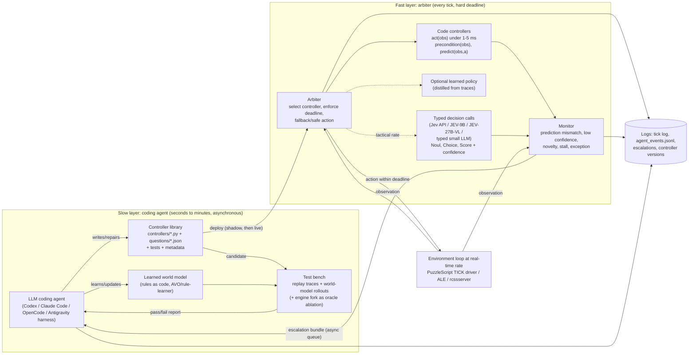

# Research direction: real-time LLM tasks — a slow coding agent that builds, monitors and repairs fast controllers

Written 2026-10-15 for the M.Sc proposal discussion (Yoav Goldberg; also to interest
Gal Kaminka). Companion data for the workbench: `realtime-llm-controllers-direction.json`.
Every external claim is linked. **[V]** = I or a research subagent opened the primary source
(arXiv abstract, official page, model card or repo) on 2026-10-15. **[S]** = known only from
secondary coverage or search snippets. **[vendor]** = a figure the company reports about itself,
not checked independently. Items without a tag follow the group's tag.

---

## 0. Elevator pitches

**For Yoav.** Frontier LLM agents can now work out the rules of an unfamiliar game and
write a solver for it. Our AVO work shows this on PuzzleScript. But they take seconds to
minutes per decision, so they cannot play anything that runs on a clock. The thesis question
is how a slow language agent should spend its reasoning when the world will not wait.
Our proposal: the agent *compiles* what it learns into fast artifacts. These are code
controllers, typed "System One" decision calls ([Jev](https://typesafe.ai/blog/introducing-system-one-models-and-jev)
and the open [JEV-27B-VL](https://huggingface.co/autotrust/JEV-27B-VL), which is built on the same Qwen 3.8-27B backbone
as our current small-model thread), and optionally a distilled policy. The agent returns to
the loop only when the fast layer reports low confidence, a prediction mismatch or novelty.
This is a direct extension of AVO solver evolution, now done online, under time pressure and
with measurable trade-offs: score against wall-clock, latency percentiles, LLM calls per
minute, and escalation precision. The closest 2026 work, [Code to Control](https://arxiv.org/abs/2609.38733),
synthesises reactive controllers offline. It does not repair them while the clock runs, and it
does not learn unknown rules.

**For Gal.** This is a modern deliberative/reactive hybrid architecture where the deliberative
layer is an LLM coding agent. It writes the behaviours that the reactive layer executes, and
it gets called back by a monitor when execution departs from expectation. The escalation trigger
is close to *socially attentive monitoring* and plan recognition
([Kaminka & Tambe, JAIR 2000](https://u.cs.biu.ac.il/~galk/publications/sort_date.html)): it
fires when expected and observed behaviour diverge, for the agent itself or for teammates.
The natural testbed is the **RoboCup Soccer Simulation 2D** server
([rcssserver](https://github.com/rcsoccersim/rcssserver), 100 ms cycles, 11 decentralised players).
Gal's group did foundational teamwork work there with ISIS (RoboCup-97). We found no published
LLM work on the 2D league. The questions are: can a coding agent act as an online "coach" that
writes, tests and repairs team behaviours (formations, set plays, role assignment) during a match?
And can teamwork monitoring decide when that slow coach must intervene? A lighter swarm variant
([VMAS](https://github.com/proroklab/VectorizedMultiAgentSimulator)) links to his current
swarm and modular-RL work.

---

## 1. How much has been done (prior work map)

### 1a. The new ingredient: "System One" decision models (Jev and relatives)

| Item | Date | What it is | Tag |
|---|---|---|---|
| [TypeSafe AI — *Introducing System One models and Jev*](https://typesafe.ai/blog/introducing-system-one-models-and-jev) | byline 15 Sep 2026 (page metadata says 15 Oct; the dates conflict) | "Unstructured state in, typed probabilistic decisions out." Questions are *Noul* (0–1), *Choice* (up to 255 options) and *Score* (ordinal rubric). Each question runs in parallel and in isolation against the same state. It "guarantees the shape of its answers, not that every decision is correct." End-to-end latency 70–500 ms [vendor]. Text/JSON only in v1.13. The launch post shows a **Doom demo** played from text state. No robotics mentioned. | [V] |
| [TypeSafe docs — System One concept](https://docs.typesafe.ai/concepts/system-one.md) | 2026 | Confidence lets you decide "when to act and when to escalate to a person or a reasoning model". No thresholds given. API is `POST /v1/systemone`. | [V] |
| [AutoTrust — JEV-9B model card](https://huggingface.co/autotrust/JEV-9B) | vision update 3 Oct 2026 | Apache-2.0. Qwen3.5-9B text tower plus LoRA and a decision head. *System 1* gives a typed answer in one forward pass; *System 2* is ordinary generation with thinking, both on the same weights. Median ~90 ms per decision (~2.5 ms batched) on a B200 [vendor]. Simulated pick-and-place: 10/20 scenes, and the card concludes "a fast visual judge, not an end-to-end controller". | [V] |
| [AutoTrust — JEV-27B-VL model card](https://huggingface.co/autotrust/JEV-27B-VL) | Oct 2026 | Unchanged **Qwen3.8-27B** weights plus a System 1 adapter and head, Apache-2.0. `/v1/decide` with 2–256 options and image states. Reports ~150 ms per decision in Super Mario Bros, ~122 ms in Tetris, ~300 ms in Snake; MuJoCo pick-and-place 75% of 20 scenes at ~240 ms per decision [vendor]. | [V] |
| [JEV-27B release coverage](https://runtimewire.com/article/autotrust-ai-jev-27b-self-hosted-decision-model) | 28 Sep 2026 | A compact decision block on a frozen Qwen3.8-27B. Not a distillation of TypeSafe's weights. | [S] |
| [Ling, Xue & Ye — *Jev in the Wild* (arXiv 2609.30216)](https://arxiv.org/abs/2609.30216) | 24 Sep 2026 | Mining study of 2,170 public Jev GitHub projects. Most use it for attribute judgement and scoring, and attention concentrates on routing and interface agents. Not about control. | [V] |
| [Ibrahim & Zaki — *Evaluating Decision Models for Text Annotation* (arXiv 2609.24574)](https://arxiv.org/abs/2609.24574) | Sep 2026 | Jev trails the best of 19 LLMs on 14/15 tasks (median −11.6 macro-F1) at about 44× lower cost. It is better calibrated than 16/19 LLMs' verbalised confidence. **Sending low-confidence items to an LLM matches or beats the LLM alone at 25–50% of its cost.** This is the deferral pattern we want, so far shown only for annotation. | [V] |
| [Sun et al. — *Type-Safe Is Not Error-Free* (arXiv 2609.26758)](https://arxiv.org/abs/2609.26758) | Sep–Oct 2026 | Typed decision models follow the option *name* rather than its bound definition: up to 70 pp more flips, and AUC falls to 23% when yes/no names are swapped. Type-error rate stays at 0%. **Design lesson:** a controller library must test its question wording. | [V] |
| `jev-router` pattern | Sep–Oct 2026 | A Jev decision picks the model tier for each request. Seen as `typesafe/jev-router` on OpenRouter and in LangChain's experimental `ModelRouterMiddleware` ([LangChain guide](https://www.langchain.com/blog/building-a-harness-with-jev)). No official repository found; several community repos share the name. | [S] |
| Secondary explainers: [DataNorth](https://datanorth.ai/blog/jev-what-it-is-and-why-this-new-model-matters), [fireup.pro](https://fireup.pro/news/what-is-jev-how-system-one-models-could-change-ai-agents), [Pooya Golchian](https://pooyagolchian.com/blog/what-is-jev-ai-decision-model-2026/) | Sep 2026 | Consistent with the primary sources. Golchian says Jev itself is proprietary with no weights; the open JEV models are a separate AutoTrust line. None of the three mentions JEV-27B, JEV-9B or jev-router. | [S] |

**Takeaway.** Hosted Jev latency (70–500 ms) is too slow for every-tick control at 10–20 Hz,
but fits a "tactical" rate of one call per 0.3–2 s. A self-hosted JEV-9B or JEV-27B-VL with
batched calls (vendor figures) could be fast enough for every tick on slow games. None of
these are controllers, by their own model cards. They are *fast judges*. That is the right
role for them in the framework: deciding which controller to run, whether the state is
dangerous, and whether to escalate.

### 1b. Code-as-policies: LLM-written controllers, rewards and world models

- **Code as Policies** (Liang et al., 2022): a code LLM writes robot policy code against perception and control APIs. [arXiv 2209.07753](https://arxiv.org/abs/2209.07753) [V]
- **ProgPrompt** (Singh et al., 2022): program-style prompts make LLM plans executable. [arXiv 2209.11302](https://arxiv.org/abs/2209.11302) [V]
- **Voyager** (Wang et al., 2023): GPT-4 writes Minecraft skills as code, repairs them from execution errors and keeps a skill library. This is the "controller library" precedent. [arXiv 2305.16291](https://arxiv.org/abs/2305.16291) [V]
- **Eureka** (Ma et al., 2023) / **DrEureka** (2024): evolutionary write-test-refine loop over reward code; DrEureka adds sim-to-real. [2310.12931](https://arxiv.org/abs/2310.12931), [2406.01967](https://arxiv.org/abs/2406.01967) [V]
- **Text2Reward** (Xie et al., 2023) and **GenSim** (Wang et al., 2023): LLMs write reward and task code. [2309.11489](https://arxiv.org/abs/2309.11489), [2310.01361](https://arxiv.org/abs/2310.01361) [V]
- **LLM-BRAIn** (2023), **BTGenBot** (2024) and **BTGenBot-2** (2026): small LLMs generate behaviour trees, checked by a validator and a simulator. [2305.19352](https://arxiv.org/abs/2305.19352), [2403.12761](https://arxiv.org/abs/2403.12761), [2602.01870](https://arxiv.org/abs/2602.01870) [V]
- **WorldCoder** (Tang, Key & Ellis, 2024), **GIF-MCTS** (Dainese et al., 2024), **PoE-World** (Piriyakulkij et al., 2025): LLMs write executable world models and plan with them. PoE-World works on Atari. [2402.12275](https://arxiv.org/abs/2402.12275), [2405.15383](https://arxiv.org/abs/2405.15383), [2505.10819](https://arxiv.org/abs/2505.10819) [V]
- **WorldTest / AutumnBench** (Warrier et al., 2025): reward-free world-model learning benchmark; humans beat frontier models. [2510.19788](https://arxiv.org/abs/2510.19788) [V]
- **Executable World Models for ARC-AGI-3 in the Era of Coding Agents** (Rodionov, AGI-2026): a coding agent maintains a Python world model and replans on failure or stall. Solves 15 of 25 public games with GPT-5.5. Turn-based. [2605.05138](https://arxiv.org/abs/2605.05138) [V]
- **LLM-GS** (Liu et al., ICLR 2025) and **From Code to Play** (Eberhardinger et al., 2024): LLM-guided search for programmatic policies (Karel, MinAtar). [2405.16450](https://arxiv.org/abs/2405.16450), [2412.04057](https://arxiv.org/abs/2412.04057) [V]
- **Learning Game-Playing Agents with Generative Code Optimization** (Kuang et al., 2025): Python Atari policies refined by an LLM, close to deep RL with far fewer interactions. [2508.19506](https://arxiv.org/abs/2508.19506) [V]
- **Code to Control: Synthesizing Parameterized Reactive Controllers** (Ahmed, Tenenbaum, Bates & Gershman, 30 Sep 2026): the LLM writes controller structure and derivative-free search fits parameters. **No LLM or planning at decision time**, so it plays in real time and selects actions faster than PPO (Atari, Flappy Bird, MuJoCo). **This is the nearest neighbour.** The abstract says nothing about runtime escalation, online repair or unknown-rule discovery. [2609.38733](https://arxiv.org/abs/2609.38733) [V]
- **AI Control Scientist** (Wang et al., Aug 2026): a multi-agent LLM system turns requirements into controller code and tunes it in closed loop. Classical control, not games. [2608.26780](https://arxiv.org/abs/2608.26780) [V]
- **AlphaEvolve** (Google DeepMind, 2025) and **AVO** (Chen et al., NVIDIA, 2026): evolutionary code improvement driven by evaluators. AVO is the base of our existing campaigns. [2506.13131](https://arxiv.org/abs/2506.13131), [2603.24517](https://arxiv.org/abs/2603.24517) [V]
- **OMNI-EPIC** (Faldor et al., 2024): foundation models write environment and reward code for open-ended learning. [2405.15568](https://arxiv.org/abs/2405.15568) [V]

### 1c. Hierarchical / dual-system "slow model + fast policy" (robotics)

- **SayCan** (2022) and **Inner Monologue** (2022): an LLM selects among fast pretrained skills and replans from text feedback. [2204.01691](https://arxiv.org/abs/2204.01691), [2207.05608](https://arxiv.org/abs/2207.05608) [V]
- **RT-2** (2023): a monolithic VLA at ~1–3 Hz (55B) or ~5 Hz (5B). It shows why a fast layer is needed. [2307.15818](https://arxiv.org/abs/2307.15818) [V]
- **RT-H** (2024): language motions as an intermediate layer that humans can correct. [2403.01823](https://arxiv.org/abs/2403.01823) [V]
- **π0** (2024): VLM plus a flow action expert, up to 50 Hz via action chunks. [2410.24164](https://arxiv.org/abs/2410.24164) [V]
- **Hi Robot** (2025): a high-level VLM re-plans about every 1 s and sends language subcommands to π0 at 10–50 Hz. [2502.19417](https://arxiv.org/abs/2502.19417) [V]
- **π0.5** (2025): one model predicts the subtask, then the action chunk. [2504.16054](https://arxiv.org/abs/2504.16054) [V]
- **π\*0.6 / Recap** (Nov 2025): learns from autonomous rollouts and interventions. [blog](https://pi.website/blog/pistar06) [V]
- **π0.7** (Apr 2026): high-level policy sends language and subgoal images. [blog](https://www.pi.website/blog/pi07) [V]
- **Real-Time Chunking** (Black et al., NeurIPS 2025): generates the next chunk while the current one executes. **This is the latency-hiding trick our fast layer needs.** [2506.07339](https://arxiv.org/abs/2506.07339) [V]
- **Figure Helix** (Feb 2025): System 2 VLM at 7–9 Hz, System 1 at 200 Hz. [figure.ai/news/helix](https://www.figure.ai/news/helix) [V]
- **NVIDIA GR00T N1** (2025): VLM at 10 Hz and DiT flow head at 120 Hz. **N1.6 / N1.7**: newer backbones. [2503.14734](https://arxiv.org/abs/2503.14734), [repo](https://github.com/NVIDIA/Isaac-GR00T) [V]. N1.5 details [S].
- **Gemini Robotics** (Mar 2025): cloud backbone under 160 ms plus a local decoder, 50 Hz effective. [2503.20020](https://arxiv.org/abs/2503.20020) [V]
- **Gemini Robotics 1.5 / ER 1.5** (Sep 2025): the ER model orchestrates and calls tools. [2510.03342](https://arxiv.org/abs/2510.03342) [V]
- **ER 1.6** (Apr 2026) decides retry or move-on. [page](https://deepmind.google/models/gemini-robotics/gemini-robotics-er/) [V]
- **Gemini Robotics 2** (Jul 2026): ER 2 plans and monitors progress for a whole-body VLA. [blog](https://deepmind.google/blog/gemini-robotics-2-brings-whole-body-intelligence-to-robots/) [V]
- **HiRT** (2024), **RoboDual** (2024), **DP-VLA** (2024), **LCB** (2024), **Hume** (2025), **FiS-VLA** (NeurIPS 2025, 117.7 Hz System 1): academic dual-system VLAs. [2410.05273](https://arxiv.org/abs/2410.05273), [2410.08001](https://arxiv.org/abs/2410.08001), [2410.15549](https://arxiv.org/abs/2410.15549), [2405.04798](https://arxiv.org/abs/2405.04798), [2505.21432](https://arxiv.org/abs/2505.21432), [2506.01953](https://arxiv.org/abs/2506.01953) [V]
- **LeCun, *A Path Towards Autonomous Machine Intelligence*** (2022): world model, cost and actor, with a "Mode-1 reactive / Mode-2 planning" split. [OpenReview](https://openreview.net/pdf?id=BZ5a1r-kVsf) [V via consistent sources; PDF not opened]
- **V-JEPA 2** (Meta, Jun 2025): the V-JEPA 2-AC latent world model plans with CEM-MPC at ~16 s per action. A slow planner, not a reflex. [2506.09985](https://arxiv.org/abs/2506.09985) [V]
- **AMI Labs** (LeCun's world-model startup, announced Mar 2026) [S]. No paper found.
- **Failure detection as an escalation signal:**
  - **REFLECT** (CoRL 2023): an LLM explains robot failures from multisensory summaries. [2306.15724](https://arxiv.org/abs/2306.15724) [V]
  - **Code-as-Monitor** (CVPR 2025): a VLM *writes constraint-checking code* that monitors in real time. **This is the closest analogue to our monitor.** [2412.04455](https://arxiv.org/abs/2412.04455) [V]

### 1d. Real-time game agents with LLMs

In nearly all of these the LLM is kept out of the fast loop. The game is paused or turn-based,
the LLM emits code or macro actions, or a fast policy reasons only sparsely.

- **StarCraft II:**
  - **TextStarCraft II** (Ma et al., 2023/NeurIPS 2024): chain of summarisation, several actions queued per call. [2312.11865](https://arxiv.org/abs/2312.11865)
  - **SwarmBrain** (2024): an LLM "Overmind" handles macro strategy, a state-machine "ReflexNet" handles micro "due to the inherent latency in LLM reasoning". [2401.17749](https://arxiv.org/abs/2401.17749)
  - **Adaptive Command** (2025): the LLM advises, a behaviour tree executes. [2508.16580](https://arxiv.org/abs/2508.16580)
  - **SEMA** (2026): over 50% lower decision latency. [2603.23875](https://arxiv.org/abs/2603.23875)
  - All [V].
- **Minecraft and 3D open worlds:**
  - **MineDojo** (2022) [2206.08853](https://arxiv.org/abs/2206.08853)
  - **DEPS** (2023): planner re-called on sub-goal failure. [2302.01560](https://arxiv.org/abs/2302.01560)
  - **JARVIS-1** (2023) [2311.05997](https://arxiv.org/abs/2311.05997)
  - **Optimus-1/2** (2024/25) [2408.03615](https://arxiv.org/abs/2408.03615), [2502.19902](https://arxiv.org/abs/2502.19902)
  - **Cradle** (2024): pauses RDR2 while waiting for the LLM. [2403.03186](https://arxiv.org/abs/2403.03186)
  - **Lumine** (2025): 5 Hz perception, 30 Hz actions, reasons only when needed. [2511.08892](https://arxiv.org/abs/2511.08892)
  - **Game-TARS** (2025): "sparse thinking". [2510.23691](https://arxiv.org/abs/2510.23691)
  - **SIMA** (2024) / **SIMA 2** (2025) [2404.10179](https://arxiv.org/abs/2404.10179), [2512.04797](https://arxiv.org/abs/2512.04797)
  - All [V].
- **Pokémon (turn-based):**
  - [Claude Plays Pokémon](https://www.anthropic.com/research/visible-extended-thinking) (2025)
  - Gemini Plays Pokémon, §4.1 of [Gemini 2.5 report](https://arxiv.org/abs/2507.06261) (2025)
  - **PokéLLMon** [2402.01118](https://arxiv.org/abs/2402.01118)
  - **PokéChamp** [2503.04094](https://arxiv.org/abs/2503.04094)
  - All [V].
- **Benchmarks:**
  - **BALROG** (2024, turn-based) [2411.13543](https://arxiv.org/abs/2411.13543)
  - **lmgame-Bench** (2025) [2505.15146](https://arxiv.org/abs/2505.15146)
  - **VideoGameBench** (2025): latency is a major obstacle; the "Lite" version pauses the game; best 0.48% / 1.6%. [2505.18134](https://arxiv.org/abs/2505.18134)
  - **Orak** (2025): pauses SC2 and SF3 during inference. [2506.03610](https://arxiv.org/abs/2506.03610)
  - **Atari-GPT** (2024): 2–7 s per action, "not yet viable" as low-level policies. [2408.15950](https://arxiv.org/abs/2408.15950)
  - **ARC-AGI-3** (2026): turn-based, scored on action efficiency. [tech report](https://arcprize.org/media/ARC_AGI_3_Technical_Report.pdf) [V; launch date S]
- **Overcooked and real-time coordination:**
  - **Overcooked-AI** (Carroll et al., 2019) [1910.05789](https://arxiv.org/abs/1910.05789)
  - **ProAgent** (2023) [2308.11339](https://arxiv.org/abs/2308.11339)
  - **HLA** — *Hierarchical Language Agent for Real-time Human-AI Coordination* (AAMAS 2024): slow-mind LLM, fast-mind light LLM and a scripted executor. [2312.15224](https://arxiv.org/abs/2312.15224)
  - **DPT-Agent** (ACL 2025): FSM plus code-as-policy as System 1, asynchronous theory-of-mind reflection as System 2. [2502.11882](https://arxiv.org/abs/2502.11882)
  - **DPMT** (2025) [2507.14088](https://arxiv.org/abs/2507.14088)
  - All [V].
- **Latency as the object of study:**
  - **Real-Time Reasoning Agents in Evolving Environments** (Wen et al., ICLR 2026): Real-Time Reasoning Gym (Freeway, Snake, Overcooked); a default action is played if the agent is late; AgileThinker runs reactive and planning modes concurrently. [2511.04898](https://arxiv.org/abs/2511.04898)
  - **LLM Colosseum** (2024): Street Fighter III, where faster models win. [GitHub](https://github.com/OpenGenerativeAI/llm-colosseum)
  - **Robotouille** (ICLR 2025): asynchronous tasks drop GPT-4o from 47% to 11%. [2502.05227](https://arxiv.org/abs/2502.05227)
  - All [V].

### 1e. LLM-as-teacher, distillation, and fast/slow routing

- **Teachers and distillation:**
  - **ELLM** (2023): LLM-suggested goals guide exploration. [2302.06692](https://arxiv.org/abs/2302.06692)
  - **Motif** (2023): LLM preferences become an intrinsic reward for NetHack RL. [2310.00166](https://arxiv.org/abs/2310.00166)
  - **LLM4Teach** (IJCAI 2024): the student RL policy surpasses its LLM teacher. [2311.13373](https://arxiv.org/abs/2311.13373)
  - **RL-GPT** (NeurIPS 2024): a slow agent decides whether a sub-action becomes code or RL. **A precedent for "the agent chooses the controller type".** [2402.19299](https://arxiv.org/abs/2402.19299)
  - **RAPID** (2024): an LLM driver distilled into a real-time RL policy. [2410.12568](https://arxiv.org/abs/2410.12568)
  - All [V]. No 2025–26 paper found that distils an LLM *game* agent into a small policy.
- **Routing, cascades and deferral:**
  - **FrugalGPT** (2023) [2305.05176](https://arxiv.org/abs/2305.05176)
  - **RouteLLM** (2024) [2406.18665](https://arxiv.org/abs/2406.18665)
  - **LM cascades with token-level uncertainty** (ICLR 2024) [2404.10136](https://arxiv.org/abs/2404.10136)
  - **Gatekeeper** (2025) [2502.19335](https://arxiv.org/abs/2502.19335)
  - **SwiftSage** (NeurIPS 2023): a small "Swift" model by default, GPT-4 "Sage" on demand. [2305.17390](https://arxiv.org/abs/2305.17390)
  - **Talker-Reasoner** (DeepMind 2024) [2410.08328](https://arxiv.org/abs/2410.08328)
  - **Learning to defer** (Mozannar & Sontag, ICML 2020) [2006.01862](https://arxiv.org/abs/2006.01862)
  - All [V].

### 1f. The gap Adam could own

These pieces exist separately:

1. **Offline** synthesis of reactive code controllers in environments with known rewards, with no LLM at runtime (Code to Control, Kuang et al., LLM-GS).
2. Slow/fast stacks in robotics where the fast layer is a *trained neural policy* and the slow layer sends language subgoals (Helix, GR00T, Hi Robot, Gemini Robotics).
3. Game agents that avoid time pressure by **pausing** (Cradle, VideoGameBench-Lite, Orak) or by **hand-written** fast layers (SwarmBrain's ReflexNet, HLA's scripted executor, DPT-Agent's FSM).
4. Turn-based coding agents that learn executable world models (WorldCoder, PoE-World, Rodionov's ARC-AGI-3 agent, our AVO).
5. Typed decision models whose deferral-to-LLM has been validated only for *text annotation* (Ibrahim & Zaki).

**What we did not find:** a coding agent that, in an environment whose rules are **unknown** and
whose clock **does not stop**, does all of the following:

- (a) learns the rules;
- (b) compiles them into a *library* of reactive code controllers plus typed decision calls, each with
  declared preconditions and predicted effects;
- (c) detects its own failures through prediction mismatch, low confidence or novelty, and **repairs
  or replaces controllers online, asynchronously, while the fast layer keeps acting**;
- (d) reports the latency–quality–cost frontier against a paused-LLM upper bound.

The escalation policy itself (when, and how often, the slow agent should be woken) is also
unstudied in control. This extends AVO directly: AVO evolves one `solver.py` offline and
turn-based, and the new work evolves a controller library online under a deadline. We checked
on 2026-10-15 and found nothing doing all of (a)–(d). Code to Control is 15 days old, and
follow-ups may appear quickly.

---

## 2. Environment / challenge options

### 2a. The bridge: real-time PuzzleScript games already in our catalog

`benchmark/games.json` has **19** games whose exclusion reasons include `realtime`. All also
carry the `realtime` tag property. The `realtime_interval` values (seconds per engine tick)
come from each `script.txt`.

| id | title | levels | interval (s) | other exclusion reasons |
|---|---|---|---|---|
| `ps_a_sneeze_a_day-v1` | A Sneeze A Day Keeps The Crates Away | 7 | 0.0666 | – |
| `ps_aaaah_i_m_being_attacked-v1` | Aaaah! I'm Being Attacked by a Giant Tentacle! | 10 | 0.6 | random_rules |
| `ps_beam_islands-v1` | Beam Islands | 8 | 0.3 | – |
| `ps_boxes_and_balloons-v1` | Boxes & Balloons | 22 | 0.1 | – |
| `ps_cyber_lasso-v1` | Cyber-Lasso | 3 | 0.05 | no_formal_win_condition, checkpoint_hidden_state |
| `ps_easy_enigma-v1` | Easy Enigma | 21 | 0.2 | random_rules |
| `ps_i_herd_u_liek_water_templs-v1` | i herd u liek water templs | 7 | 0.22 | random_rules |
| `ps_liquid_war_alpha-v1` | Liquid War Alpha | 1 | 0.1 | no_formal_win_condition, random_rules |
| `ps_magik-v1` | Magik | 4 | 0.5 | – |
| `ps_oskars_maze-v1` | Oskar's Maze | 4 | 0.05 | – |
| `ps_pretender_to_the_crown-v1` | pretender to the crown | 16 | 0.1 | random_rules |
| `ps_pushcat_jr-v1` | Pushcat Jr | 8 | 0.3 | – |
| `ps_skipping_stones-v1` | Skipping Stones to Lonely Homes | 1 | 0.1 | no_formal_win_condition, checkpoint_hidden_state |
| `ps_slime_swap-v1` | Slime Swap | 15 | 0.1 | random_rules |
| `ps_some_lines_crossed-v1` | Some lines were meant to be crossed | 7 | 0.06 | – |
| `ps_spikes_n_stuff-v1` | Spikes 'n' Stuff | 1 | 0.05 | random_rules, checkpoint_hidden_state |
| `ps_spooky_pumpkin_game-v1` | Spooky Pumpkin Game | 16 | 0.15 | random_rules |
| `ps_tidy_the_cafe-v1` | Tidy the Cafe! | 6 | 0.1 | random_rules |
| `ps_vines-v1` | Vines | 1 | 0.1 | checkpoint_hidden_state |

**Seven are excluded only for `realtime`:** Sneeze, Beam Islands, Boxes & Balloons, Magik,
Oskar's Maze, Pushcat Jr and Some Lines. These are deterministic with a formal win condition,
which makes them the cleanest first targets.

**Caveats:**

- **Runtime gap:** `puzzlescript_interface/runtime/server.js` currently advances the engine only
  after an input. It ticks while `hasAgain()` holds, up to 50 ticks. There is no "wait/tick" action
  and no wall clock, so these games are effectively frozen between moves today. The npm engine's
  `tick()` does honour `realtimeInterval` (`node_modules/puzzlescript/lib/engine.js:939`), so the
  fix is small: add a `TICK` no-op action and a driver that ticks every `interval × slowdown`.
- **Not yet audited:** which of the 19 have *real* time pressure (hazards, falling objects, a
  chasing tentacle) and which only use the timer for cosmetic animation. Do this audit first,
  before choosing games.

### 2b. Options table

The ★ column marks the recommended shortlist.

| # | Environment | Real-time? | Rules | Observation | Action rate | Setup | Compute | Multi-agent | Fit to PuzzleScript work | Main risk | ★ |
|---|---|---|---|---|---|---|---|---|---|---|---|
| 1 | **PuzzleScript real-time subset** (ours, §2a) | Engine ticks every 0.05–0.6 s; needs a `TICK` action + clock driver (~1–2 days) | **Unknown** to the agent; games are obscure, so little contamination | Grid IDs + PNG (existing) | 1.7–20 Hz | Low (existing stack, harnesses, AVO) | CPU | No (some multi-avatar) | Perfect continuity: same games, gateway, world models, evaluator | Some games may be only cosmetically real-time; small, idiosyncratic set | ★ continuity |
| 2 | **Real-Time Reasoning Gym** (Freeway, Snake, Overcooked; [repo](https://github.com/SALT-NLP/RealtimeGym), [paper](https://arxiv.org/abs/2511.04898)) | Yes; budget in tokens or seconds, default action when late | Known (described in text) | Text / symbolic | Configurable | Low (`pip install -e .`) | CPU + LLM | Overcooked is 2-player | Ready-made real-time LLM baseline (AgileThinker) to beat | Rules are given, so it doesn't test rule learning; simple games | – |
| 3 | **ALE / Atari** ([ale-py](https://ale.farama.org/), v0.12.1 Aug 2026) | Native 60 Hz; v5 has frameskip 4 + sticky actions (≈15 decisions/s) | Unknown in principle, but **heavily in pretraining** | Pixels or 128-byte RAM | ~15 Hz | Low (pip) | CPU | Mostly single | Same comparison set as Code to Control, PoE-World, Kuang et al., Atari-GPT | Contamination; reviewers will ask "why not PPO"; pixels need a perception layer | ★ ML community |
| 4 | **Craftax / Crafter** ([Craftax](https://github.com/MichaelTMatthews/Craftax), ICML 2024) | Step-synchronous; impose a wall clock ourselves | Partly known (Minecraft-like) | Symbolic or pixels | Ours to choose | Low (pip, JAX) | CPU/GPU | No | Open-ended, long horizon; ELLM/Motif/BALROG lineage | Not inherently real-time; strong RL baselines | – |
| 5 | **Overcooked-AI** ([repo](https://github.com/HumanCompatibleAI/overcooked_ai); JaxMARL variant) | Step-synchronous, but the coordination literature runs it in real time with humans | Known | Symbolic grid | set by the experimenter; several steps/s in human studies [S] | Low–medium (PyPI release dates from 2021; install from repo) | CPU | **2 agents** (human–AI) | HLA, DPT-Agent and ProAgent give direct fast/slow baselines | Crowded topic; partner modelling dominates the problem | – |
| 6 | **ViZDoom** ([repo](https://github.com/Farama-Foundation/ViZDoom), v1.3.2 Oct 2026) | **Async real-time mode** at 35 tics/s, plus a sync mode | Known genre; custom WADs make rules unknown | Pixels, depth, labels, game variables | Up to 35 Hz | Low (pip) | CPU | Multiplayer | Jev's own launch demo is Doom, so the typed-decision vs code comparison is natural | Shooter rather than puzzle; perception-heavy | – |
| 7 | **Google Research Football** ([repo](https://github.com/google-research/football)) | Step-synchronous, ~10 steps/s of game time | Known (football) | Pixels, minimap or 115-d vector | ~10 Hz | Medium | CPU | Up to 11 controlled | Soccer without RoboCup infrastructure | **Archived Aug 2026, last release 2022** | – |
| 8 | **RoboCup Soccer Simulation 2D** ([rcssserver](https://github.com/rcsoccersim/rcssserver) v19, 2024; [Pyrus2D](https://github.com/Cyrus2D/Pyrus2D); [CLSFramework](https://arxiv.org/abs/2406.05621); [R2D-RL](https://arxiv.org/abs/2606.18786)) | **Yes**: 100 ms cycles, 6000 cycles per match; optional sync mode | Known physics; **opponent unknown**; team behaviour is the learned part | Symbolic, noisy, partial (text over UDP) | 10 Hz per player | Medium (Linux / Docker build; Python bases exist) | CPU | **11 v 11 decentralised + coach** | Coding agent as online coach; HELIOS/agent2d as strong scripted baseline | No LLM prior work; Linux-only build; a full team is engineering-heavy | ★ Gal |
| 9 | **Swarm / multi-robot sim**: [VMAS](https://github.com/proroklab/VectorizedMultiAgentSimulator) (pip, 1.5.2 Nov 2025) or [ARGoS](https://www.argos-sim.info/) (Lua, Linux/macOS, last release 2021) | Step-synchronous; impose a clock | Task known, emergent dynamics unknown | Symbolic local sensing | Ours (e.g. 10 Hz) | Low (VMAS) / medium (ARGoS) | CPU/GPU | **Tens–thousands of agents** | Agent writes *local rules* and monitors collective behaviour | Hard to define "rules to learn"; ARGoS is stale | – |
| 10 | **Lifelong MAPF / warehouse** ([League of Robot Runners](https://leagueofrobotrunners.org/), [paper](https://arxiv.org/abs/2404.16162)) | **Hard planning deadline per step (~1 s)** | Known | Symbolic grid | 1 Hz, up to 10k agents | Medium (C++ start kit) | CPU | Massively | Deadline-bounded planning; agent writes and repairs heuristics (AVO-like) | Rules are fully known; LLM adds little at runtime | – |
| 11 | **Manipulation**: [MuJoCo](https://mujoco.org/) / [MuJoCo Playground](https://arxiv.org/abs/2502.08844) / [ManiSkill3](https://github.com/haosulab/ManiSkill) / Isaac Lab | Physics at kHz, control at 20–50 Hz | Known physics, unknown object properties | State, RGB-D | 20–50 Hz | High (Isaac needs an RTX GPU; ManiSkill is mainly Linux) | GPU | Usually single | Compares with VLA dual systems; JEV-27B-VL reports a MuJoCo pick-and-place demo | Heavy; far from current expertise; the community expects VLAs | – |

### 2c. Robotics-flavoured options for Gal

- **RoboCup 2D (option 8).**
  - *Research question:* can a slow coding agent, acting as coach, write, test and **repair team
    behaviours online** (formations, set plays, pass-selection heuristics, role allocation) against
    an unknown opponent? And does **teamwork monitoring** — detecting when teammates' observed
    behaviour departs from the plan, in the spirit of socially-attentive monitoring and team plan
    recognition — make a better escalation trigger than confidence alone?
  - *Why his group:* ISIS (RoboCup-97) and the explicit-teamwork-model papers (AIJ 1999, JAIR 2000)
    are his. He also has team-behaviour classification (2008), RoboCup proceedings editing (2002),
    and current interests listed as "LLM-based agentic systems" and "Cognitive LLM-based Agents"
    on his [homepage](https://u.cs.biu.ac.il/~galk/).
  - *Practical route:* Pyrus2D (pure Python) or CLSFramework's Python decision server on top of
    HELIOS, so controllers are Python.
- **Swarm (option 9, VMAS first).**
  - *Research question:* the agent writes the *local* rule set, and the monitor checks *collective*
    predictions (cohesion, coverage rate). Escalate when the collective behaviour deviates.
  - *Why his group:* matches his 2025–26 swarm papers (*Swarms Can be Rational*, *Pausing Makes
    Perfect*, *Modular RL for Cooperative Swarms*, locust-inspired collective motion).
- **Coverage / patrolling or lifelong MAPF (option 10).**
  - *Why his group:* his multi-robot coverage and adversarial patrolling line (2007–2018).
  - *Research question:* deadline-bounded replanning, where the coding agent writes and repairs the
    heuristic offline and the runtime must answer within 1 s.

### 2d. Recommended shortlist (one per audience)

1. **Continuity: PuzzleScript real-time subset.**
   - Reuses everything: the games, harnesses, AVO, the tool gateway and the rule-learning world
     models.
   - It is the only option that is real-time *and* has unknown rules *and* is uncontaminated.
   - It makes the thesis story "turn-based rule learning → real-time control" on the same games.
   - The slowdown factor (paused → 4× slow → real speed) gives a clean, controllable
     time-pressure axis.
2. **ML community: ALE/Atari, a small subset (5–8 games).**
   - It is where the nearest neighbours report results (Code to Control, PoE-World, Kuang et al.,
     Atari-GPT), so the comparison is direct.
   - Sticky actions and a 15 Hz deadline make real-time meaningful.
   - Contamination is a known caveat; PuzzleScript answers it.
   - Alternative: Real-Time Reasoning Gym, if a ready-made LLM real-time baseline matters more than
     pixels.
3. **Gal: RoboCup Soccer Simulation 2D.**
   - Real-time by construction, multi-agent and partially observable.
   - It has strong scripted baselines and no LLM prior work.
   - It plays to his teamwork and monitoring research.
   - Start with a 3v3 or 5v5 sub-game and a Python base, not a full 11-player team.

---

## 3. Framework sketch

Working name: **Coder–Controller loop**. The slow agent writes and repairs controllers; the fast
layer runs them under a deadline.

### 3a. Components

- **Slow coding agent.**
  - Any existing harness in `harnesses/` (same Docker image, same `agent_events.jsonl`).
  - It is never on the critical path: it reads escalation bundles from a queue and publishes new
    controller versions.
- **Controller library.** Every controller is a Python module with:
  - `precondition(obs) -> bool`;
  - `act(obs, memory) -> action`, with a hard budget (e.g. ≤ 5 ms);
  - `predict(obs, action) -> expected features` (or invariants) for the monitor;
  - tests (replayed traces with expected actions or outcomes);
  - metadata: author turn, version, scope (game / level / situation) and lineage.

  Typed decision *questions* are first-class library items. Each has state-serialisation code plus
  a question spec, and is tested against labelled traces. This is needed because typed models
  follow option *names* (Sun et al. 2026).
- **Arbiter (fast layer).**
  - Runs every tick: chooses the active controller (by precondition, or by a typed `Choice` over
    controllers at the tactical rate) and enforces the deadline.
  - If anything misses the deadline, it plays the controller's last committed plan or a declared
    safe action (`TICK`/no-op).
  - This borrows the Real-Time Chunking idea: commit to a short action chunk while the next decision
    is computed.
- **Decision service.**
  - One interface, `decide(state, questions) -> {answer, probs, confidence}`.
  - Backends:
    - hosted Jev;
    - self-hosted JEV-9B or JEV-27B-VL (Apache-2.0; the 27B shares the backbone with our Qwen 3.8-27B work);
    - a "typed small LLM" (Qwen + constrained decoding) as an open control.
- **Optional learned policy.** Behaviour cloning on (obs, action) pairs from controller and paused-LLM
  traces, for situations no controller covers. This is a stretch goal.
- **Monitor and escalation.** Sends the agent an *escalation bundle*: the last N ticks, active
  controller, mismatch details, decision probabilities, and the world-model diff.

### 3b. Escalation protocol (when the fast layer defers to the slow agent)

Triggers, from cheapest to most expensive:

1. **Exception or deadline overrun** in a controller.
2. **No applicable controller**: every precondition is false.
3. **Prediction mismatch**: the observed transition violates `predict()` or the world model, i.e.
   a rule was wrong or a new mechanic appeared. In AVO terms, this is a world-model falsification.
4. **Low confidence**: decision confidence < τ. Calibrate τ per question on replayed traces, as in
   Ibrahim & Zaki's deferral result.
5. **Novelty**: unseen tile IDs or objects, a new level, or a layout far from the tested ones.
6. **Stall**: no progress signal (subgoal, score, level) for K ticks.

Rules:

- **Hysteresis and rate limit:** at most E escalations per minute; deduplicate by trigger signature.
- **The fast layer keeps acting**, with the fallback controller, while the agent works.
- **Pause is an explicit, logged budget**, not a default. A "paused" condition is an upper-bound
  baseline, not part of the method.

### 3c. Controller lifecycle

**propose → test → shadow → deploy → monitor → repair or retire**

1. **Propose.** The agent writes the controller, its tests, preconditions and predictions.
2. **Test.**
   - Unit tests on stored traces.
   - Rollouts in the *learned* world model.
   - Optionally, rollouts in a forked real engine. This is an "oracle simulator" ablation: easy for
     PuzzleScript via `checkpoint/restore`, impossible for official ARC.
3. **Shadow.** The controller runs alongside the live one and its predictions are scored, but it
   does not act.
4. **Deploy.** It is promoted when shadow accuracy and test pass rate clear thresholds.
5. **Monitor.** Track success, mismatch, escalation and deadline-miss rates per controller.
6. **Repair.** The agent receives the failure bundle and patches the controller. Every stored
   failure trace becomes a regression test.
7. **Retire.** Remove controllers that are dominated or unused. Between episodes, **AVO evolution**
   can improve the library offline: the evaluator is the same per-controller score.

### 3d. Latency budget (design numbers to measure, not results)

| Layer | Rate | Budget | Mechanism |
|---|---|---|---|
| Reflex (code controllers) | every tick (PuzzleScript 50–600 ms; ALE ≈ 67 ms; rcssserver 100 ms) | ≤ 5 ms p99 | in-process Python |
| Tactical (typed decisions) | every k ticks / 0.3–2 s | p99 < tick period − margin when synchronous; otherwise asynchronous with a committed chunk | Jev hosted 70–500 ms [vendor]; JEV-9B ~90 ms median, ~2.5 ms batched on B200 [vendor] |
| Strategic (coding agent) | event-driven | 10 s – minutes, never synchronous | harness turn on escalation |

Rule: any call that is synchronous on the tick path must have measured p99 below the tick
period. Everything else is asynchronous.

### 3e. What is logged

- **Per tick:** time, observation hash, active controller and version, action, latency of each
  layer, deadline met or missed, monitor flags.
- **Per decision call:** questions, answer, probabilities, confidence, latency, backend.
- **Per escalation:** trigger, bundle, agent turn id, resulting controller diff, time-to-deploy.
- **Per controller version:** tests, shadow score, live score, retirement reason.
- **The agent:** the existing `agent_events.jsonl` schema (`role: optimizer|player`), extended with
  a `controller` role.

### 3f. Reuse of existing pieces

- **Harnesses** (`harnesses/`, one Docker image): the slow agent.
- **AVO** (`avo/`):
  - evolution operators and evaluator for offline improvement of the controller library;
  - the solver contract generalises from "one `solver.py`" to "library + arbiter".
- **Tool gateway** (`avo/core/tool_gateway.py`):
  - `probe/checkpoint/restore` become the test bench and the oracle-sim ablation;
  - the gateway stays the only path to real actions, which preserves the evidence integrity AVO
    already enforces.
- **Rule-learning world models** (thesis main line): they feed `predict()` and the monitor. A
  falsified rule becomes an escalation trigger. This is the conceptual bridge between the current
  thesis and the new direction.
- **Workbench:** run catalog, replay and compare views; a new "latency" panel reads the tick log.

### 3g. Evaluation

**Metrics:**

- score or levels solved against wall-clock time;
- score against LLM tokens and dollars;
- decision latency p50/p95/p99;
- deadline-miss rate (ticks where the fallback was used);
- LLM calls per minute and cost per minute;
- escalation rate;
- escalation precision (escalations that led to a controller change that improved outcome) and
  recall (failures that were not escalated);
- time-to-repair;
- controller reuse (across levels and games);
- fraction of ticks under code control.

**Baselines:**

- **B0 — paused LLM every step.** The game freezes while the LLM thinks. This is the quality upper
  bound and the current turn-based condition.
- **B1 — LLM every step, real time.** Default action when late. Real-Time Reasoning Gym style.
- **B2 — fast-only, frozen.** Controllers written once at the start and never repaired. A Code to
  Control-like ablation.
- **B3 — decision model every tick.** A typed `Choice` over primitive actions.
- **B4 — AgileThinker-style** concurrent reactive and planning LLM.
- **B5 — scripted or expert.** HELIOS for RoboCup; a hand-written solver for PuzzleScript; random.
- **B6 — PPO** where cheap (ALE).

### 3h. Minimal first experiment (≈ 2 weeks, PuzzleScript only)

**Hypothesis.** As time pressure rises (slowdown 8× → 4× → 2× → 1×), B1 (LLM every step,
real time) falls sharply while the Coder–Controller loop stays close to B0 (paused) at a small
fraction of B0's calls per minute.

**Week 1 (infrastructure).**

1. Audit the 7 games excluded only for `realtime` for genuine time pressure, and choose 3–4.
   Likely candidates, unconfirmed: Pushcat Jr (gravity, falling boulders), Boxes & Balloons
   (gravity, spikes), Magik and Beam Islands.
2. Add a `TICK` no-op action and a clock driver to the runtime. The driver ticks every
   `realtime_interval × slowdown` whether or not an action arrived, and applies the latest action
   once per tick.
3. Implement a minimal arbiter:
   - loads `controllers/*.py` from the agent's workspace, hot-reloading on a version bump;
   - enforces the deadline and has a fallback;
   - monitors (exception, no controller, `predict()` mismatch, stall);
   - escalates through a file queue the harness reads, like the existing gateway RPC.
4. Write the tick log.

**Week 2 (runs).** One frontier harness (Claude Code or Codex). Each game × slowdown {8, 4, 1} ×
2 seeds, under four conditions:

- **B0** — paused, every step;
- **B1** — real time, every step;
- **C1** — Coder–Controller loop with code controllers only;
- **C2** — C1 plus one typed tactical question ("which controller?" or "is the player in
  danger?"), answered by hosted Jev or a self-hosted JEV-9B.

**Deliverable.**

- One figure: levels solved against slowdown, per condition.
- One table: p95 latency, deadline misses, calls per minute, escalation precision.
- Five annotated escalation and repair episodes.

**Out of scope for the first experiment:** Gal's RoboCup track (a later 2–3 week spike on a 3v3
sub-game with Pyrus2D) and the learned policy.

---

## 4. Open issues and what could not be verified

**Jev:**

- No model size or architecture is published. Latency and cost figures are vendor-reported.
- The TypeSafe launch-post date conflicts (byline 15 Sep vs page metadata 15 Oct 2026). Early
  access on 15 Sep is consistent across secondary sources.
- **"JEV-9B vision" is real but small.** The JEV-9B card says "now takes images" (3 Oct 2026
  update). The headline vision model is JEV-27B-VL.
- All robot, game and computer-use numbers on the AutoTrust cards are self-reported.
- "jev-router" is a *pattern* with several community implementations and an OpenRouter listing,
  not a single official project.
- arXiv 2609.30216 is verified, but it is an ecosystem mining study, not a technical description of Jev.

**Other:**

- **GR00T N1.5 details and AMI Labs' technical direction:** secondary sources only.
- **Kaminka:**
  - His publications page confirms ISIS, RoboCup, behaviour-based teamwork, coverage, patrolling
    and swarm work, plus a 2026 paper *A Language for Describing Agentic LLM Contexts*.
  - I did not read his 2026 papers and found no Kaminka paper on LLM control. Note that
    `docs/proposal/main.tex` already lists him as a supervisor.
- **Real-time PuzzleScript audit:** which games create real time pressure is still open (§2a).
