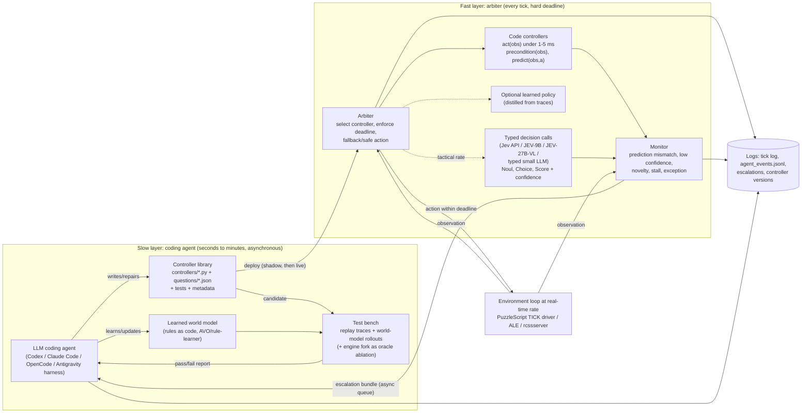

# Research direction: real-time LLM tasks — a slow coding agent that builds, monitors and repairs fast controllers

Written 2026-10-15 for the M.Sc proposal discussion (Yoav Goldberg; also to interest
Gal Kaminka). Companion data for the workbench: `realtime-llm-controllers-direction.json`.
Every external claim is linked. **[V]** = I or a research subagent opened the primary source
(arXiv abstract, official page, model card or repo) on 2026-10-15. **[S]** = known only from
secondary coverage or search snippets. **[vendor]** = a figure the company reports about itself,
not checked independently. Items without a tag follow the group's tag.

**Update 21 Oct 2026:** §5 at the end has the new entries, corrections and the restated gap
(the picture changed: several neighbours appeared between 26 Sep and 20 Oct). The presentation
page for 22 Oct is `thursday-20261022-realtime.html`. Sections 0–4 are left as written on 15 Oct.

---

## 0. Elevator pitches

**For Yoav.** Frontier LLM agents can now work out the rules of an unfamiliar game and
write a solver for it. Our AVO work shows this on PuzzleScript. But they take seconds to
minutes per decision, so they cannot play anything that runs on a clock. The thesis question
is how a slow language agent should spend its reasoning when the world will not wait.
Our proposal: the agent *compiles* what it learns into fast artifacts. These are code
controllers, typed "System One" decision calls ([Jev](https://typesafe.ai/blog/introducing-system-one-models-and-jev)
and the open [JEV-27B-VL](https://huggingface.co/autotrust/JEV-27B-VL), which is built on the same Qwen 3.8-27B backbone
as our current small-model thread), and optionally a distilled policy. The agent returns to
the loop only when the fast layer reports low confidence, a prediction mismatch or novelty.
This is a direct extension of AVO solver evolution, now done online, under time pressure and
with measurable trade-offs: score against wall-clock, latency percentiles, LLM calls per
minute, and escalation precision. The closest 2026 work, [Code to Control](https://arxiv.org/abs/2609.38733),
synthesises reactive controllers offline. It does not repair them while the clock runs, and it
does not learn unknown rules.

**For Gal.** This is a modern deliberative/reactive hybrid architecture where the deliberative
layer is an LLM coding agent. It writes the behaviours that the reactive layer executes, and
it gets called back by a monitor when execution departs from expectation. The escalation trigger
is close to *socially attentive monitoring* and plan recognition
([Kaminka & Tambe, JAIR 2000](https://u.cs.biu.ac.il/~galk/publications/sort_date.html)): it
fires when expected and observed behaviour diverge, for the agent itself or for teammates.
The natural testbed is the **RoboCup Soccer Simulation 2D** server
([rcssserver](https://github.com/rcsoccersim/rcssserver), 100 ms cycles, 11 decentralised players).
Gal's group did foundational teamwork work there with ISIS (RoboCup-97). We found no published
LLM work on the 2D league. The questions are: can a coding agent act as an online "coach" that
writes, tests and repairs team behaviours (formations, set plays, role assignment) during a match?
And can teamwork monitoring decide when that slow coach must intervene? A lighter swarm variant
([VMAS](https://github.com/proroklab/VectorizedMultiAgentSimulator)) links to his current
swarm and modular-RL work.

---

## 1. How much has been done (prior work map)

### 1a. The new ingredient: "System One" decision models (Jev and relatives)

| Item | Date | What it is | Tag |
|---|---|---|---|
| [TypeSafe AI — *Introducing System One models and Jev*](https://typesafe.ai/blog/introducing-system-one-models-and-jev) | byline 15 Sep 2026 (page metadata says 15 Oct; the dates conflict) | "Unstructured state in, typed probabilistic decisions out." Questions are *Noul* (0–1), *Choice* (up to 255 options) and *Score* (ordinal rubric). Each question runs in parallel and in isolation against the same state. It "guarantees the shape of its answers, not that every decision is correct." End-to-end latency 70–500 ms [vendor]. Text/JSON only in v1.13. The launch post shows a **Doom demo** played from text state. No robotics mentioned. | [V] |
| [TypeSafe docs — System One concept](https://docs.typesafe.ai/concepts/system-one.md) | 2026 | Confidence lets you decide "when to act and when to escalate to a person or a reasoning model". No thresholds given. API is `POST /v1/systemone`. | [V] |
| [AutoTrust — JEV-9B model card](https://huggingface.co/autotrust/JEV-9B) | vision update 3 Oct 2026 | Apache-2.0. Qwen3.5-9B text tower plus LoRA and a decision head. *System 1* gives a typed answer in one forward pass; *System 2* is ordinary generation with thinking, both on the same weights. Median ~90 ms per decision (~2.5 ms batched) on a B200 [vendor]. Simulated pick-and-place: 10/20 scenes, and the card concludes "a fast visual judge, not an end-to-end controller". | [V] |
| [AutoTrust — JEV-27B-VL model card](https://huggingface.co/autotrust/JEV-27B-VL) | Oct 2026 | Unchanged **Qwen3.8-27B** weights plus a System 1 adapter and head, Apache-2.0. `/v1/decide` with 2–256 options and image states. Reports ~150 ms per decision in Super Mario Bros, ~122 ms in Tetris, ~300 ms in Snake; MuJoCo pick-and-place 75% of 20 scenes at ~240 ms per decision [vendor]. | [V] |
| [JEV-27B release coverage](https://runtimewire.com/article/autotrust-ai-jev-27b-self-hosted-decision-model) | 28 Sep 2026 | A compact decision block on a frozen Qwen3.8-27B. Not a distillation of TypeSafe's weights. | [S] |
| [Ling, Xue & Ye — *Jev in the Wild* (arXiv 2609.30216)](https://arxiv.org/abs/2609.30216) | 24 Sep 2026 | Mining study of 2,170 public Jev GitHub projects. Most use it for attribute judgement and scoring, and attention concentrates on routing and interface agents. Not about control. | [V] |
| [Ibrahim & Zaki — *Evaluating Decision Models for Text Annotation* (arXiv 2609.24574)](https://arxiv.org/abs/2609.24574) | Sep 2026 | Jev trails the best of 19 LLMs on 14/15 tasks (median −11.6 macro-F1) at about 44× lower cost. It is better calibrated than 16/19 LLMs' verbalised confidence. **Sending low-confidence items to an LLM matches or beats the LLM alone at 25–50% of its cost.** This is the deferral pattern we want, so far shown only for annotation. | [V] |
| [Sun et al. — *Type-Safe Is Not Error-Free* (arXiv 2609.26758)](https://arxiv.org/abs/2609.26758) | Sep–Oct 2026 | Typed decision models follow the option *name* rather than its bound definition: up to 70 pp more flips, and AUC falls to 23% when yes/no names are swapped. Type-error rate stays at 0%. **Design lesson:** a controller library must test its question wording. | [V] |
| `jev-router` pattern | Sep–Oct 2026 | A Jev decision picks the model tier for each request. Seen as `typesafe/jev-router` on OpenRouter and in LangChain's experimental `ModelRouterMiddleware` ([LangChain guide](https://www.langchain.com/blog/building-a-harness-with-jev)). No official repository found; several community repos share the name. | [S] |
| Secondary explainers: [DataNorth](https://datanorth.ai/blog/jev-what-it-is-and-why-this-new-model-matters), [fireup.pro](https://fireup.pro/news/what-is-jev-how-system-one-models-could-change-ai-agents), [Pooya Golchian](https://pooyagolchian.com/blog/what-is-jev-ai-decision-model-2026/) | Sep 2026 | Consistent with the primary sources. Golchian says Jev itself is proprietary with no weights; the open JEV models are a separate AutoTrust line. None of the three mentions JEV-27B, JEV-9B or jev-router. | [S] |

**Takeaway.** Hosted Jev latency (70–500 ms) is too slow for every-tick control at 10–20 Hz,
but fits a "tactical" rate of one call per 0.3–2 s. A self-hosted JEV-9B or JEV-27B-VL with
batched calls (vendor figures) could be fast enough for every tick on slow games. None of
these are controllers, by their own model cards. They are *fast judges*. That is the right
role for them in the framework: deciding which controller to run, whether the state is
dangerous, and whether to escalate.

### 1b. Code-as-policies: LLM-written controllers, rewards and world models

- **Code as Policies** (Liang et al., 2022): a code LLM writes robot policy code against perception and control APIs. [arXiv 2209.07753](https://arxiv.org/abs/2209.07753) [V]
- **ProgPrompt** (Singh et al., 2022): program-style prompts make LLM plans executable. [arXiv 2209.11302](https://arxiv.org/abs/2209.11302) [V]
- **Voyager** (Wang et al., 2023): GPT-4 writes Minecraft skills as code, repairs them from execution errors and keeps a skill library. This is the "controller library" precedent. [arXiv 2305.16291](https://arxiv.org/abs/2305.16291) [V]
- **Eureka** (Ma et al., 2023) / **DrEureka** (2024): evolutionary write-test-refine loop over reward code; DrEureka adds sim-to-real. [2310.12931](https://arxiv.org/abs/2310.12931), [2406.01967](https://arxiv.org/abs/2406.01967) [V]
- **Text2Reward** (Xie et al., 2023) and **GenSim** (Wang et al., 2023): LLMs write reward and task code. [2309.11489](https://arxiv.org/abs/2309.11489), [2310.01361](https://arxiv.org/abs/2310.01361) [V]
- **LLM-BRAIn** (2023), **BTGenBot** (2024) and **BTGenBot-2** (2026): small LLMs generate behaviour trees, checked by a validator and a simulator. [2305.19352](https://arxiv.org/abs/2305.19352), [2403.12761](https://arxiv.org/abs/2403.12761), [2602.01870](https://arxiv.org/abs/2602.01870) [V]
- **WorldCoder** (Tang, Key & Ellis, 2024), **GIF-MCTS** (Dainese et al., 2024), **PoE-World** (Piriyakulkij et al., 2025): LLMs write executable world models and plan with them. PoE-World works on Atari. [2402.12275](https://arxiv.org/abs/2402.12275), [2405.15383](https://arxiv.org/abs/2405.15383), [2505.10819](https://arxiv.org/abs/2505.10819) [V]
- **WorldTest / AutumnBench** (Warrier et al., 2025): reward-free world-model learning benchmark; humans beat frontier models. [2510.19788](https://arxiv.org/abs/2510.19788) [V]
- **Executable World Models for ARC-AGI-3 in the Era of Coding Agents** (Rodionov, AGI-2026): a coding agent maintains a Python world model and replans on failure or stall. Solves 15 of 25 public games with GPT-5.5. Turn-based. [2605.05138](https://arxiv.org/abs/2605.05138) [V]
- **LLM-GS** (Liu et al., ICLR 2025) and **From Code to Play** (Eberhardinger et al., 2024): LLM-guided search for programmatic policies (Karel, MinAtar). [2405.16450](https://arxiv.org/abs/2405.16450), [2412.04057](https://arxiv.org/abs/2412.04057) [V]
- **Learning Game-Playing Agents with Generative Code Optimization** (Kuang et al., 2025): Python Atari policies refined by an LLM, close to deep RL with far fewer interactions. [2508.19506](https://arxiv.org/abs/2508.19506) [V]
- **Code to Control: Synthesizing Parameterized Reactive Controllers** (Ahmed, Tenenbaum, Bates & Gershman, 30 Sep 2026): the LLM writes controller structure and derivative-free search fits parameters. **No LLM or planning at decision time**, so it plays in real time and selects actions faster than PPO (Atari, Flappy Bird, MuJoCo). **This is the nearest neighbour.** The abstract says nothing about runtime escalation, online repair or unknown-rule discovery. [2609.38733](https://arxiv.org/abs/2609.38733) [V]
- **AI Control Scientist** (Wang et al., Aug 2026): a multi-agent LLM system turns requirements into controller code and tunes it in closed loop. Classical control, not games. [2608.26780](https://arxiv.org/abs/2608.26780) [V]
- **AlphaEvolve** (Google DeepMind, 2025) and **AVO** (Chen et al., NVIDIA, 2026): evolutionary code improvement driven by evaluators. AVO is the base of our existing campaigns. [2506.13131](https://arxiv.org/abs/2506.13131), [2603.24517](https://arxiv.org/abs/2603.24517) [V]
- **OMNI-EPIC** (Faldor et al., 2024): foundation models write environment and reward code for open-ended learning. [2405.15568](https://arxiv.org/abs/2405.15568) [V]

### 1c. Hierarchical / dual-system "slow model + fast policy" (robotics)

- **SayCan** (2022) and **Inner Monologue** (2022): an LLM selects among fast pretrained skills and replans from text feedback. [2204.01691](https://arxiv.org/abs/2204.01691), [2207.05608](https://arxiv.org/abs/2207.05608) [V]
- **RT-2** (2023): a monolithic VLA at ~1–3 Hz (55B) or ~5 Hz (5B). It shows why a fast layer is needed. [2307.15818](https://arxiv.org/abs/2307.15818) [V]
- **RT-H** (2024): language motions as an intermediate layer that humans can correct. [2403.01823](https://arxiv.org/abs/2403.01823) [V]
- **π0** (2024): VLM plus a flow action expert, up to 50 Hz via action chunks. [2410.24164](https://arxiv.org/abs/2410.24164) [V]
- **Hi Robot** (2025): a high-level VLM re-plans about every 1 s and sends language subcommands to π0 at 10–50 Hz. [2502.19417](https://arxiv.org/abs/2502.19417) [V]
- **π0.5** (2025): one model predicts the subtask, then the action chunk. [2504.16054](https://arxiv.org/abs/2504.16054) [V]
- **π\*0.6 / Recap** (Nov 2025): learns from autonomous rollouts and interventions. [blog](https://pi.website/blog/pistar06) [V]
- **π0.7** (Apr 2026): high-level policy sends language and subgoal images. [blog](https://www.pi.website/blog/pi07) [V]
- **Real-Time Chunking** (Black et al., NeurIPS 2025): generates the next chunk while the current one executes. **This is the latency-hiding trick our fast layer needs.** [2506.07339](https://arxiv.org/abs/2506.07339) [V]
- **Figure Helix** (Feb 2025): System 2 VLM at 7–9 Hz, System 1 at 200 Hz. [figure.ai/news/helix](https://www.figure.ai/news/helix) [V]
- **NVIDIA GR00T N1** (2025): VLM at 10 Hz and DiT flow head at 120 Hz. **N1.6 / N1.7**: newer backbones. [2503.14734](https://arxiv.org/abs/2503.14734), [repo](https://github.com/NVIDIA/Isaac-GR00T) [V]. N1.5 details [S].
- **Gemini Robotics** (Mar 2025): cloud backbone under 160 ms plus a local decoder, 50 Hz effective. [2503.20020](https://arxiv.org/abs/2503.20020) [V]
- **Gemini Robotics 1.5 / ER 1.5** (Sep 2025): the ER model orchestrates and calls tools. [2510.03342](https://arxiv.org/abs/2510.03342) [V]
- **ER 1.6** (Apr 2026) decides retry or move-on. [page](https://deepmind.google/models/gemini-robotics/gemini-robotics-er/) [V]
- **Gemini Robotics 2** (Jul 2026): ER 2 plans and monitors progress for a whole-body VLA. [blog](https://deepmind.google/blog/gemini-robotics-2-brings-whole-body-intelligence-to-robots/) [V]
- **HiRT** (2024), **RoboDual** (2024), **DP-VLA** (2024), **LCB** (2024), **Hume** (2025), **FiS-VLA** (NeurIPS 2025, 117.7 Hz System 1): academic dual-system VLAs. [2410.05273](https://arxiv.org/abs/2410.05273), [2410.08001](https://arxiv.org/abs/2410.08001), [2410.15549](https://arxiv.org/abs/2410.15549), [2405.04798](https://arxiv.org/abs/2405.04798), [2505.21432](https://arxiv.org/abs/2505.21432), [2506.01953](https://arxiv.org/abs/2506.01953) [V]
- **LeCun, *A Path Towards Autonomous Machine Intelligence*** (2022): world model, cost and actor, with a "Mode-1 reactive / Mode-2 planning" split. [OpenReview](https://openreview.net/pdf?id=BZ5a1r-kVsf) [V via consistent sources; PDF not opened]
- **V-JEPA 2** (Meta, Jun 2025): the V-JEPA 2-AC latent world model plans with CEM-MPC at ~16 s per action. A slow planner, not a reflex. [2506.09985](https://arxiv.org/abs/2506.09985) [V]
- **AMI Labs** (LeCun's world-model startup, announced Mar 2026) [S]. No paper found.
- **Failure detection as an escalation signal:**
  - **REFLECT** (CoRL 2023): an LLM explains robot failures from multisensory summaries. [2306.15724](https://arxiv.org/abs/2306.15724) [V]
  - **Code-as-Monitor** (CVPR 2025): a VLM *writes constraint-checking code* that monitors in real time. **This is the closest analogue to our monitor.** [2412.04455](https://arxiv.org/abs/2412.04455) [V]

### 1d. Real-time game agents with LLMs

In nearly all of these the LLM is kept out of the fast loop. The game is paused or turn-based,
the LLM emits code or macro actions, or a fast policy reasons only sparsely.

- **StarCraft II:**
  - **TextStarCraft II** (Ma et al., 2023/NeurIPS 2024): chain of summarisation, several actions queued per call. [2312.11865](https://arxiv.org/abs/2312.11865)
  - **SwarmBrain** (2024): an LLM "Overmind" handles macro strategy, a state-machine "ReflexNet" handles micro "due to the inherent latency in LLM reasoning". [2401.17749](https://arxiv.org/abs/2401.17749)
  - **Adaptive Command** (2025): the LLM advises, a behaviour tree executes. [2508.16580](https://arxiv.org/abs/2508.16580)
  - **SEMA** (2026): over 50% lower decision latency. [2603.23875](https://arxiv.org/abs/2603.23875)
  - All [V].
- **Minecraft and 3D open worlds:**
  - **MineDojo** (2022) [2206.08853](https://arxiv.org/abs/2206.08853)
  - **DEPS** (2023): planner re-called on sub-goal failure. [2302.01560](https://arxiv.org/abs/2302.01560)
  - **JARVIS-1** (2023) [2311.05997](https://arxiv.org/abs/2311.05997)
  - **Optimus-1/2** (2024/25) [2408.03615](https://arxiv.org/abs/2408.03615), [2502.19902](https://arxiv.org/abs/2502.19902)
  - **Cradle** (2024): pauses RDR2 while waiting for the LLM. [2403.03186](https://arxiv.org/abs/2403.03186)
  - **Lumine** (2025): 5 Hz perception, 30 Hz actions, reasons only when needed. [2511.08892](https://arxiv.org/abs/2511.08892)
  - **Game-TARS** (2025): "sparse thinking". [2510.23691](https://arxiv.org/abs/2510.23691)
  - **SIMA** (2024) / **SIMA 2** (2025) [2404.10179](https://arxiv.org/abs/2404.10179), [2512.04797](https://arxiv.org/abs/2512.04797)
  - All [V].
- **Pokémon (turn-based):**
  - [Claude Plays Pokémon](https://www.anthropic.com/research/visible-extended-thinking) (2025)
  - Gemini Plays Pokémon, §4.1 of [Gemini 2.5 report](https://arxiv.org/abs/2507.06261) (2025)
  - **PokéLLMon** [2402.01118](https://arxiv.org/abs/2402.01118)
  - **PokéChamp** [2503.04094](https://arxiv.org/abs/2503.04094)
  - All [V].
- **Benchmarks:**
  - **BALROG** (2024, turn-based) [2411.13543](https://arxiv.org/abs/2411.13543)
  - **lmgame-Bench** (2025) [2505.15146](https://arxiv.org/abs/2505.15146)
  - **VideoGameBench** (2025): latency is a major obstacle; the "Lite" version pauses the game; best 0.48% / 1.6%. [2505.18134](https://arxiv.org/abs/2505.18134)
  - **Orak** (2025): pauses SC2 and SF3 during inference. [2506.03610](https://arxiv.org/abs/2506.03610)
  - **Atari-GPT** (2024): 2–7 s per action, "not yet viable" as low-level policies. [2408.15950](https://arxiv.org/abs/2408.15950)
  - **ARC-AGI-3** (2026): turn-based, scored on action efficiency. [tech report](https://arcprize.org/media/ARC_AGI_3_Technical_Report.pdf) [V; launch date S]
- **Overcooked and real-time coordination:**
  - **Overcooked-AI** (Carroll et al., 2019) [1910.05789](https://arxiv.org/abs/1910.05789)
  - **ProAgent** (2023) [2308.11339](https://arxiv.org/abs/2308.11339)
  - **HLA** — *Hierarchical Language Agent for Real-time Human-AI Coordination* (AAMAS 2024): slow-mind LLM, fast-mind light LLM and a scripted executor. [2312.15224](https://arxiv.org/abs/2312.15224)
  - **DPT-Agent** (ACL 2025): FSM plus code-as-policy as System 1, asynchronous theory-of-mind reflection as System 2. [2502.11882](https://arxiv.org/abs/2502.11882)
  - **DPMT** (2025) [2507.14088](https://arxiv.org/abs/2507.14088)
  - All [V].
- **Latency as the object of study:**
  - **Real-Time Reasoning Agents in Evolving Environments** (Wen et al., ICLR 2026): Real-Time Reasoning Gym (Freeway, Snake, Overcooked); a default action is played if the agent is late; AgileThinker runs reactive and planning modes concurrently. [2511.04898](https://arxiv.org/abs/2511.04898)
  - **LLM Colosseum** (2024): Street Fighter III, where faster models win. [GitHub](https://github.com/OpenGenerativeAI/llm-colosseum)
  - **Robotouille** (ICLR 2025): asynchronous tasks drop GPT-4o from 47% to 11%. [2502.05227](https://arxiv.org/abs/2502.05227)
  - All [V].

### 1e. LLM-as-teacher, distillation, and fast/slow routing

- **Teachers and distillation:**
  - **ELLM** (2023): LLM-suggested goals guide exploration. [2302.06692](https://arxiv.org/abs/2302.06692)
  - **Motif** (2023): LLM preferences become an intrinsic reward for NetHack RL. [2310.00166](https://arxiv.org/abs/2310.00166)
  - **LLM4Teach** (IJCAI 2024): the student RL policy surpasses its LLM teacher. [2311.13373](https://arxiv.org/abs/2311.13373)
  - **RL-GPT** (NeurIPS 2024): a slow agent decides whether a sub-action becomes code or RL. **A precedent for "the agent chooses the controller type".** [2402.19299](https://arxiv.org/abs/2402.19299)
  - **RAPID** (2024): an LLM driver distilled into a real-time RL policy. [2410.12568](https://arxiv.org/abs/2410.12568)
  - All [V]. No 2025–26 paper found that distils an LLM *game* agent into a small policy.
- **Routing, cascades and deferral:**
  - **FrugalGPT** (2023) [2305.05176](https://arxiv.org/abs/2305.05176)
  - **RouteLLM** (2024) [2406.18665](https://arxiv.org/abs/2406.18665)
  - **LM cascades with token-level uncertainty** (ICLR 2024) [2404.10136](https://arxiv.org/abs/2404.10136)
  - **Gatekeeper** (2025) [2502.19335](https://arxiv.org/abs/2502.19335)
  - **SwiftSage** (NeurIPS 2023): a small "Swift" model by default, GPT-4 "Sage" on demand. [2305.17390](https://arxiv.org/abs/2305.17390)
  - **Talker-Reasoner** (DeepMind 2024) [2410.08328](https://arxiv.org/abs/2410.08328)
  - **Learning to defer** (Mozannar & Sontag, ICML 2020) [2006.01862](https://arxiv.org/abs/2006.01862)
  - All [V].

### 1f. The gap Adam could own

These pieces exist separately:

1. **Offline** synthesis of reactive code controllers in environments with known rewards, with no LLM at runtime (Code to Control, Kuang et al., LLM-GS).
2. Slow/fast stacks in robotics where the fast layer is a *trained neural policy* and the slow layer sends language subgoals (Helix, GR00T, Hi Robot, Gemini Robotics).
3. Game agents that avoid time pressure by **pausing** (Cradle, VideoGameBench-Lite, Orak) or by **hand-written** fast layers (SwarmBrain's ReflexNet, HLA's scripted executor, DPT-Agent's FSM).
4. Turn-based coding agents that learn executable world models (WorldCoder, PoE-World, Rodionov's ARC-AGI-3 agent, our AVO).
5. Typed decision models whose deferral-to-LLM has been validated only for *text annotation* (Ibrahim & Zaki).

**What we did not find:** a coding agent that, in an environment whose rules are **unknown** and
whose clock **does not stop**, does all of the following:

- (a) learns the rules;
- (b) compiles them into a *library* of reactive code controllers plus typed decision calls, each with
  declared preconditions and predicted effects;
- (c) detects its own failures through prediction mismatch, low confidence or novelty, and **repairs
  or replaces controllers online, asynchronously, while the fast layer keeps acting**;
- (d) reports the latency–quality–cost frontier against a paused-LLM upper bound.

The escalation policy itself (when, and how often, the slow agent should be woken) is also
unstudied in control. This extends AVO directly: AVO evolves one `solver.py` offline and
turn-based, and the new work evolves a controller library online under a deadline. We checked
on 2026-10-15 and found nothing doing all of (a)–(d). Code to Control is 15 days old, and
follow-ups may appear quickly.

---

## 2. Environment / challenge options

### 2a. The bridge: real-time PuzzleScript games already in our catalog

`benchmark/games.json` has **19** games whose exclusion reasons include `realtime`. All also
carry the `realtime` tag property. The `realtime_interval` values (seconds per engine tick)
come from each `script.txt`.

| id | title | levels | interval (s) | other exclusion reasons |
|---|---|---|---|---|
| `ps_a_sneeze_a_day-v1` | A Sneeze A Day Keeps The Crates Away | 7 | 0.0666 | – |
| `ps_aaaah_i_m_being_attacked-v1` | Aaaah! I'm Being Attacked by a Giant Tentacle! | 10 | 0.6 | random_rules |
| `ps_beam_islands-v1` | Beam Islands | 8 | 0.3 | – |
| `ps_boxes_and_balloons-v1` | Boxes & Balloons | 22 | 0.1 | – |
| `ps_cyber_lasso-v1` | Cyber-Lasso | 3 | 0.05 | no_formal_win_condition, checkpoint_hidden_state |
| `ps_easy_enigma-v1` | Easy Enigma | 21 | 0.2 | random_rules |
| `ps_i_herd_u_liek_water_templs-v1` | i herd u liek water templs | 7 | 0.22 | random_rules |
| `ps_liquid_war_alpha-v1` | Liquid War Alpha | 1 | 0.1 | no_formal_win_condition, random_rules |
| `ps_magik-v1` | Magik | 4 | 0.5 | – |
| `ps_oskars_maze-v1` | Oskar's Maze | 4 | 0.05 | – |
| `ps_pretender_to_the_crown-v1` | pretender to the crown | 16 | 0.1 | random_rules |
| `ps_pushcat_jr-v1` | Pushcat Jr | 8 | 0.3 | – |
| `ps_skipping_stones-v1` | Skipping Stones to Lonely Homes | 1 | 0.1 | no_formal_win_condition, checkpoint_hidden_state |
| `ps_slime_swap-v1` | Slime Swap | 15 | 0.1 | random_rules |
| `ps_some_lines_crossed-v1` | Some lines were meant to be crossed | 7 | 0.06 | – |
| `ps_spikes_n_stuff-v1` | Spikes 'n' Stuff | 1 | 0.05 | random_rules, checkpoint_hidden_state |
| `ps_spooky_pumpkin_game-v1` | Spooky Pumpkin Game | 16 | 0.15 | random_rules |
| `ps_tidy_the_cafe-v1` | Tidy the Cafe! | 6 | 0.1 | random_rules |
| `ps_vines-v1` | Vines | 1 | 0.1 | checkpoint_hidden_state |

**Seven are excluded only for `realtime`:** Sneeze, Beam Islands, Boxes & Balloons, Magik,
Oskar's Maze, Pushcat Jr and Some Lines. These are deterministic with a formal win condition,
which makes them the cleanest first targets.

**Caveats:**

- **Runtime gap:** `puzzlescript_interface/runtime/server.js` currently advances the engine only
  after an input. It ticks while `hasAgain()` holds, up to 50 ticks. There is no "wait/tick" action
  and no wall clock, so these games are effectively frozen between moves today. The npm engine's
  `tick()` does honour `realtimeInterval` (`node_modules/puzzlescript/lib/engine.js:939`), so the
  fix is small: add a `TICK` no-op action and a driver that ticks every `interval × slowdown`.
- **Not yet audited:** which of the 19 have *real* time pressure (hazards, falling objects, a
  chasing tentacle) and which only use the timer for cosmetic animation. Do this audit first,
  before choosing games.

### 2b. Options table

The ★ column marks the recommended shortlist.

| # | Environment | Real-time? | Rules | Observation | Action rate | Setup | Compute | Multi-agent | Fit to PuzzleScript work | Main risk | ★ |
|---|---|---|---|---|---|---|---|---|---|---|---|
| 1 | **PuzzleScript real-time subset** (ours, §2a) | Engine ticks every 0.05–0.6 s; needs a `TICK` action + clock driver (~1–2 days) | **Unknown** to the agent; games are obscure, so little contamination | Grid IDs + PNG (existing) | 1.7–20 Hz | Low (existing stack, harnesses, AVO) | CPU | No (some multi-avatar) | Perfect continuity: same games, gateway, world models, evaluator | Some games may be only cosmetically real-time; small, idiosyncratic set | ★ continuity |
| 2 | **Real-Time Reasoning Gym** (Freeway, Snake, Overcooked; [repo](https://github.com/SALT-NLP/RealtimeGym), [paper](https://arxiv.org/abs/2511.04898)) | Yes; budget in tokens or seconds, default action when late | Known (described in text) | Text / symbolic | Configurable | Low (`pip install -e .`) | CPU + LLM | Overcooked is 2-player | Ready-made real-time LLM baseline (AgileThinker) to beat | Rules are given, so it doesn't test rule learning; simple games | – |
| 3 | **ALE / Atari** ([ale-py](https://ale.farama.org/), v0.12.1 Aug 2026) | Native 60 Hz; v5 has frameskip 4 + sticky actions (≈15 decisions/s) | Unknown in principle, but **heavily in pretraining** | Pixels or 128-byte RAM | ~15 Hz | Low (pip) | CPU | Mostly single | Same comparison set as Code to Control, PoE-World, Kuang et al., Atari-GPT | Contamination; reviewers will ask "why not PPO"; pixels need a perception layer | ★ ML community |
| 4 | **Craftax / Crafter** ([Craftax](https://github.com/MichaelTMatthews/Craftax), ICML 2024) | Step-synchronous; impose a wall clock ourselves | Partly known (Minecraft-like) | Symbolic or pixels | Ours to choose | Low (pip, JAX) | CPU/GPU | No | Open-ended, long horizon; ELLM/Motif/BALROG lineage | Not inherently real-time; strong RL baselines | – |
| 5 | **Overcooked-AI** ([repo](https://github.com/HumanCompatibleAI/overcooked_ai); JaxMARL variant) | Step-synchronous, but the coordination literature runs it in real time with humans | Known | Symbolic grid | set by the experimenter; several steps/s in human studies [S] | Low–medium (PyPI release dates from 2021; install from repo) | CPU | **2 agents** (human–AI) | HLA, DPT-Agent and ProAgent give direct fast/slow baselines | Crowded topic; partner modelling dominates the problem | – |
| 6 | **ViZDoom** ([repo](https://github.com/Farama-Foundation/ViZDoom), v1.3.2 Oct 2026) | **Async real-time mode** at 35 tics/s, plus a sync mode | Known genre; custom WADs make rules unknown | Pixels, depth, labels, game variables | Up to 35 Hz | Low (pip) | CPU | Multiplayer | Jev's own launch demo is Doom, so the typed-decision vs code comparison is natural | Shooter rather than puzzle; perception-heavy | – |
| 7 | **Google Research Football** ([repo](https://github.com/google-research/football)) | Step-synchronous, ~10 steps/s of game time | Known (football) | Pixels, minimap or 115-d vector | ~10 Hz | Medium | CPU | Up to 11 controlled | Soccer without RoboCup infrastructure | **Archived Aug 2026, last release 2022** | – |
| 8 | **RoboCup Soccer Simulation 2D** ([rcssserver](https://github.com/rcsoccersim/rcssserver) v19, 2024; [Pyrus2D](https://github.com/Cyrus2D/Pyrus2D); [CLSFramework](https://arxiv.org/abs/2406.05621); [R2D-RL](https://arxiv.org/abs/2606.18786)) | **Yes**: 100 ms cycles, 6000 cycles per match; optional sync mode | Known physics; **opponent unknown**; team behaviour is the learned part | Symbolic, noisy, partial (text over UDP) | 10 Hz per player | Medium (Linux / Docker build; Python bases exist) | CPU | **11 v 11 decentralised + coach** | Coding agent as online coach; HELIOS/agent2d as strong scripted baseline | No LLM prior work; Linux-only build; a full team is engineering-heavy | ★ Gal |
| 9 | **Swarm / multi-robot sim**: [VMAS](https://github.com/proroklab/VectorizedMultiAgentSimulator) (pip, 1.5.2 Nov 2025) or [ARGoS](https://www.argos-sim.info/) (Lua, Linux/macOS, last release 2021) | Step-synchronous; impose a clock | Task known, emergent dynamics unknown | Symbolic local sensing | Ours (e.g. 10 Hz) | Low (VMAS) / medium (ARGoS) | CPU/GPU | **Tens–thousands of agents** | Agent writes *local rules* and monitors collective behaviour | Hard to define "rules to learn"; ARGoS is stale | – |
| 10 | **Lifelong MAPF / warehouse** ([League of Robot Runners](https://leagueofrobotrunners.org/), [paper](https://arxiv.org/abs/2404.16162)) | **Hard planning deadline per step (~1 s)** | Known | Symbolic grid | 1 Hz, up to 10k agents | Medium (C++ start kit) | CPU | Massively | Deadline-bounded planning; agent writes and repairs heuristics (AVO-like) | Rules are fully known; LLM adds little at runtime | – |
| 11 | **Manipulation**: [MuJoCo](https://mujoco.org/) / [MuJoCo Playground](https://arxiv.org/abs/2502.08844) / [ManiSkill3](https://github.com/haosulab/ManiSkill) / Isaac Lab | Physics at kHz, control at 20–50 Hz | Known physics, unknown object properties | State, RGB-D | 20–50 Hz | High (Isaac needs an RTX GPU; ManiSkill is mainly Linux) | GPU | Usually single | Compares with VLA dual systems; JEV-27B-VL reports a MuJoCo pick-and-place demo | Heavy; far from current expertise; the community expects VLAs | – |

### 2c. Robotics-flavoured options for Gal

- **RoboCup 2D (option 8).**
  - *Research question:* can a slow coding agent, acting as coach, write, test and **repair team
    behaviours online** (formations, set plays, pass-selection heuristics, role allocation) against
    an unknown opponent? And does **teamwork monitoring** — detecting when teammates' observed
    behaviour departs from the plan, in the spirit of socially-attentive monitoring and team plan
    recognition — make a better escalation trigger than confidence alone?
  - *Why his group:* ISIS (RoboCup-97) and the explicit-teamwork-model papers (AIJ 1999, JAIR 2000)
    are his. He also has team-behaviour classification (2008), RoboCup proceedings editing (2002),
    and current interests listed as "LLM-based agentic systems" and "Cognitive LLM-based Agents"
    on his [homepage](https://u.cs.biu.ac.il/~galk/).
  - *Practical route:* Pyrus2D (pure Python) or CLSFramework's Python decision server on top of
    HELIOS, so controllers are Python.
- **Swarm (option 9, VMAS first).**
  - *Research question:* the agent writes the *local* rule set, and the monitor checks *collective*
    predictions (cohesion, coverage rate). Escalate when the collective behaviour deviates.
  - *Why his group:* matches his 2025–26 swarm papers (*Swarms Can be Rational*, *Pausing Makes
    Perfect*, *Modular RL for Cooperative Swarms*, locust-inspired collective motion).
- **Coverage / patrolling or lifelong MAPF (option 10).**
  - *Why his group:* his multi-robot coverage and adversarial patrolling line (2007–2018).
  - *Research question:* deadline-bounded replanning, where the coding agent writes and repairs the
    heuristic offline and the runtime must answer within 1 s.

### 2d. Recommended shortlist (one per audience)

1. **Continuity: PuzzleScript real-time subset.**
   - Reuses everything: the games, harnesses, AVO, the tool gateway and the rule-learning world
     models.
   - It is the only option that is real-time *and* has unknown rules *and* is uncontaminated.
   - It makes the thesis story "turn-based rule learning → real-time control" on the same games.
   - The slowdown factor (paused → 4× slow → real speed) gives a clean, controllable
     time-pressure axis.
2. **ML community: ALE/Atari, a small subset (5–8 games).**
   - It is where the nearest neighbours report results (Code to Control, PoE-World, Kuang et al.,
     Atari-GPT), so the comparison is direct.
   - Sticky actions and a 15 Hz deadline make real-time meaningful.
   - Contamination is a known caveat; PuzzleScript answers it.
   - Alternative: Real-Time Reasoning Gym, if a ready-made LLM real-time baseline matters more than
     pixels.
3. **Gal: RoboCup Soccer Simulation 2D.**
   - Real-time by construction, multi-agent and partially observable.
   - It has strong scripted baselines and no LLM prior work.
   - It plays to his teamwork and monitoring research.
   - Start with a 3v3 or 5v5 sub-game and a Python base, not a full 11-player team.

---

## 3. Framework sketch

Working name: **Coder–Controller loop**. The slow agent writes and repairs controllers; the fast
layer runs them under a deadline.

### 3a. Components

- **Slow coding agent.**
  - Any existing harness in `harnesses/` (same Docker image, same `agent_events.jsonl`).
  - It is never on the critical path: it reads escalation bundles from a queue and publishes new
    controller versions.
- **Controller library.** Every controller is a Python module with:
  - `precondition(obs) -> bool`;
  - `act(obs, memory) -> action`, with a hard budget (e.g. ≤ 5 ms);
  - `predict(obs, action) -> expected features` (or invariants) for the monitor;
  - tests (replayed traces with expected actions or outcomes);
  - metadata: author turn, version, scope (game / level / situation) and lineage.

  Typed decision *questions* are first-class library items. Each has state-serialisation code plus
  a question spec, and is tested against labelled traces. This is needed because typed models
  follow option *names* (Sun et al. 2026).
- **Arbiter (fast layer).**
  - Runs every tick: chooses the active controller (by precondition, or by a typed `Choice` over
    controllers at the tactical rate) and enforces the deadline.
  - If anything misses the deadline, it plays the controller's last committed plan or a declared
    safe action (`TICK`/no-op).
  - This borrows the Real-Time Chunking idea: commit to a short action chunk while the next decision
    is computed.
- **Decision service.**
  - One interface, `decide(state, questions) -> {answer, probs, confidence}`.
  - Backends:
    - hosted Jev;
    - self-hosted JEV-9B or JEV-27B-VL (Apache-2.0; the 27B shares the backbone with our Qwen 3.8-27B work);
    - a "typed small LLM" (Qwen + constrained decoding) as an open control.
- **Optional learned policy.** Behaviour cloning on (obs, action) pairs from controller and paused-LLM
  traces, for situations no controller covers. This is a stretch goal.
- **Monitor and escalation.** Sends the agent an *escalation bundle*: the last N ticks, active
  controller, mismatch details, decision probabilities, and the world-model diff.

### 3b. Escalation protocol (when the fast layer defers to the slow agent)

Triggers, from cheapest to most expensive:

1. **Exception or deadline overrun** in a controller.
2. **No applicable controller**: every precondition is false.
3. **Prediction mismatch**: the observed transition violates `predict()` or the world model, i.e.
   a rule was wrong or a new mechanic appeared. In AVO terms, this is a world-model falsification.
4. **Low confidence**: decision confidence < τ. Calibrate τ per question on replayed traces, as in
   Ibrahim & Zaki's deferral result.
5. **Novelty**: unseen tile IDs or objects, a new level, or a layout far from the tested ones.
6. **Stall**: no progress signal (subgoal, score, level) for K ticks.

Rules:

- **Hysteresis and rate limit:** at most E escalations per minute; deduplicate by trigger signature.
- **The fast layer keeps acting**, with the fallback controller, while the agent works.
- **Pause is an explicit, logged budget**, not a default. A "paused" condition is an upper-bound
  baseline, not part of the method.

### 3c. Controller lifecycle

**propose → test → shadow → deploy → monitor → repair or retire**

1. **Propose.** The agent writes the controller, its tests, preconditions and predictions.
2. **Test.**
   - Unit tests on stored traces.
   - Rollouts in the *learned* world model.
   - Optionally, rollouts in a forked real engine. This is an "oracle simulator" ablation: easy for
     PuzzleScript via `checkpoint/restore`, impossible for official ARC.
3. **Shadow.** The controller runs alongside the live one and its predictions are scored, but it
   does not act.
4. **Deploy.** It is promoted when shadow accuracy and test pass rate clear thresholds.
5. **Monitor.** Track success, mismatch, escalation and deadline-miss rates per controller.
6. **Repair.** The agent receives the failure bundle and patches the controller. Every stored
   failure trace becomes a regression test.
7. **Retire.** Remove controllers that are dominated or unused. Between episodes, **AVO evolution**
   can improve the library offline: the evaluator is the same per-controller score.

### 3d. Latency budget (design numbers to measure, not results)

| Layer | Rate | Budget | Mechanism |
|---|---|---|---|
| Reflex (code controllers) | every tick (PuzzleScript 50–600 ms; ALE ≈ 67 ms; rcssserver 100 ms) | ≤ 5 ms p99 | in-process Python |
| Tactical (typed decisions) | every k ticks / 0.3–2 s | p99 < tick period − margin when synchronous; otherwise asynchronous with a committed chunk | Jev hosted 70–500 ms [vendor]; JEV-9B ~90 ms median, ~2.5 ms batched on B200 [vendor] |
| Strategic (coding agent) | event-driven | 10 s – minutes, never synchronous | harness turn on escalation |

Rule: any call that is synchronous on the tick path must have measured p99 below the tick
period. Everything else is asynchronous.

### 3e. What is logged

- **Per tick:** time, observation hash, active controller and version, action, latency of each
  layer, deadline met or missed, monitor flags.
- **Per decision call:** questions, answer, probabilities, confidence, latency, backend.
- **Per escalation:** trigger, bundle, agent turn id, resulting controller diff, time-to-deploy.
- **Per controller version:** tests, shadow score, live score, retirement reason.
- **The agent:** the existing `agent_events.jsonl` schema (`role: optimizer|player`), extended with
  a `controller` role.

### 3f. Reuse of existing pieces

- **Harnesses** (`harnesses/`, one Docker image): the slow agent.
- **AVO** (`avo/`):
  - evolution operators and evaluator for offline improvement of the controller library;
  - the solver contract generalises from "one `solver.py`" to "library + arbiter".
- **Tool gateway** (`avo/core/tool_gateway.py`):
  - `probe/checkpoint/restore` become the test bench and the oracle-sim ablation;
  - the gateway stays the only path to real actions, which preserves the evidence integrity AVO
    already enforces.
- **Rule-learning world models** (thesis main line): they feed `predict()` and the monitor. A
  falsified rule becomes an escalation trigger. This is the conceptual bridge between the current
  thesis and the new direction.
- **Workbench:** run catalog, replay and compare views; a new "latency" panel reads the tick log.

### 3g. Evaluation

**Metrics:**

- score or levels solved against wall-clock time;
- score against LLM tokens and dollars;
- decision latency p50/p95/p99;
- deadline-miss rate (ticks where the fallback was used);
- LLM calls per minute and cost per minute;
- escalation rate;
- escalation precision (escalations that led to a controller change that improved outcome) and
  recall (failures that were not escalated);
- time-to-repair;
- controller reuse (across levels and games);
- fraction of ticks under code control.

**Baselines:**

- **B0 — paused LLM every step.** The game freezes while the LLM thinks. This is the quality upper
  bound and the current turn-based condition.
- **B1 — LLM every step, real time.** Default action when late. Real-Time Reasoning Gym style.
- **B2 — fast-only, frozen.** Controllers written once at the start and never repaired. A Code to
  Control-like ablation.
- **B3 — decision model every tick.** A typed `Choice` over primitive actions.
- **B4 — AgileThinker-style** concurrent reactive and planning LLM.
- **B5 — scripted or expert.** HELIOS for RoboCup; a hand-written solver for PuzzleScript; random.
- **B6 — PPO** where cheap (ALE).

### 3h. Minimal first experiment (≈ 2 weeks, PuzzleScript only)

**Hypothesis.** As time pressure rises (slowdown 8× → 4× → 2× → 1×), B1 (LLM every step,
real time) falls sharply while the Coder–Controller loop stays close to B0 (paused) at a small
fraction of B0's calls per minute.

**Week 1 (infrastructure).**

1. Audit the 7 games excluded only for `realtime` for genuine time pressure, and choose 3–4.
   Likely candidates, unconfirmed: Pushcat Jr (gravity, falling boulders), Boxes & Balloons
   (gravity, spikes), Magik and Beam Islands.
2. Add a `TICK` no-op action and a clock driver to the runtime. The driver ticks every
   `realtime_interval × slowdown` whether or not an action arrived, and applies the latest action
   once per tick.
3. Implement a minimal arbiter:
   - loads `controllers/*.py` from the agent's workspace, hot-reloading on a version bump;
   - enforces the deadline and has a fallback;
   - monitors (exception, no controller, `predict()` mismatch, stall);
   - escalates through a file queue the harness reads, like the existing gateway RPC.
4. Write the tick log.

**Week 2 (runs).** One frontier harness (Claude Code or Codex). Each game × slowdown {8, 4, 1} ×
2 seeds, under four conditions:

- **B0** — paused, every step;
- **B1** — real time, every step;
- **C1** — Coder–Controller loop with code controllers only;
- **C2** — C1 plus one typed tactical question ("which controller?" or "is the player in
  danger?"), answered by hosted Jev or a self-hosted JEV-9B.

**Deliverable.**

- One figure: levels solved against slowdown, per condition.
- One table: p95 latency, deadline misses, calls per minute, escalation precision.
- Five annotated escalation and repair episodes.

**Out of scope for the first experiment:** Gal's RoboCup track (a later 2–3 week spike on a 3v3
sub-game with Pyrus2D) and the learned policy.

---

## 4. Open issues and what could not be verified

**Jev:**

- No model size or architecture is published. Latency and cost figures are vendor-reported.
- The TypeSafe launch-post date conflicts (byline 15 Sep vs page metadata 15 Oct 2026). Early
  access on 15 Sep is consistent across secondary sources.
- **"JEV-9B vision" is real but small.** The JEV-9B card says "now takes images" (3 Oct 2026
  update). The headline vision model is JEV-27B-VL.
- All robot, game and computer-use numbers on the AutoTrust cards are self-reported.
- "jev-router" is a *pattern* with several community implementations and an OpenRouter listing,
  not a single official project.
- arXiv 2609.30216 is verified, but it is an ecosystem mining study, not a technical description of Jev.

**Other:**

- **GR00T N1.5 details and AMI Labs' technical direction:** secondary sources only.
- **Kaminka:**
  - His publications page confirms ISIS, RoboCup, behaviour-based teamwork, coverage, patrolling
    and swarm work, plus a 2026 paper *A Language for Describing Agentic LLM Contexts*.
  - I did not read his 2026 papers and found no Kaminka paper on LLM control. Note that
    `docs/proposal/main.tex` already lists him as a supervisor.
- **Real-time PuzzleScript audit:** which games create real time pressure is still open (§2a).

---

## 5. Update 21 Oct 2026

Refresh for the 22 Oct discussion. Method: WebSearch and WebFetch of primary pages, arXiv API
listings sorted by submission date (queries on real-time + LLM + game/agent, reactive/programmatic
controllers, code-as-policies, Jev / System One), and three research subagents on the slices
(game agents; LLM-written controllers; dual-system, distillation and routing). Tags as in the
header; **[V]** now also covers pages a subagent opened on 21 Oct. The companion JSON was not
updated.

### 5a. Decision models: the landscape changed in five weeks

| Item | Date | What | Tag |
|---|---|---|---|
| [Jev 1.14.0](https://vercel.com/i/what-is-jev) (TypeSafe) | 14 Oct 2026 (coverage); "available on AI Gateway on October 15, 2026" (Vercel) | Experimental image input, a `box` (bounding-box) question type and long context, behind opt-in flags; TypeSafe says the three are not ready for production. Model id `typesafe-ai/jev-1.14.0`. Jev 1.13 remains the stable default. TypeSafe's blog index lists the post "Jev: For the builders AND dreamers" without a date. | [V] Vercel page and blog index; date and "danger zone" wording [S] ([MarkTechPost 14 Oct](https://www.marktechpost.com/2026/10/14/typesafe-ai-jev-1-14-images-box-long-context/) returned 403) |
| [TypeSafe launch post](https://typesafe.ai/blog/introducing-system-one-models-and-jev), re-read | byline 15 Sep; page metadata now 19 Oct 2026 | Doom demo "on structured state as a data structure with text, not on images"; the engineer "worried about making 10 queries a second (which ends up costing ~$7/hour)". No version number on the page. | [V] |
| [OpenAI Decisions API](https://developers.openai.com/api/docs/guides/decisions) | public beta 6 Oct 2026 [S]; "we expect to GA in the coming weeks" | `POST /v1/decisions`, only `gpt-6-luna`; question types `predicate`, `choice`, `score`; text and images; "about 10x faster than the Responses API"; $0.10 per million input tokens, no output charge. | [V] docs; launch date [S] |
| [Microsoft-Decision-1](https://the-decoder.com/microsofts-decision-1-model-enters-the-fast-growing-ai-decision-model-race/) (Foundry, OpenRouter) | Oct 2026 (The Decoder, 10 Oct) | Post-trained Qwen3.5-9B; noul / choice / score; text only; $0.042 per million input tokens; 85 ms and "most accurate across 36 benchmarks, ~150k questions, 83.5%" [vendor]. | [S] (the Foundry blog body did not load) |
| [Decision 2.0 Kai-0.6B … Vega-27B](https://huggingface.co/vllm-sr/Decision-2.0-Vega-27B) (vLLM Semantic Router) | 2 Oct 2026 [S]; card benchmark snapshot 28 Sep | Apache-2.0. Vega-27B on **Qwen3.8-27B** (model tree), 29.37B parameters, 32k context, text or JSON, choice / yes-no / score; "a median of 71.4 ms per single-question request on a single GPU" [vendor]. Served through Transformers with `trust_remote_code`; no vLLM recipe on the card. | [V] card; release date [S] |
| [Clef, Clef-flash](https://www.theregister.com/a/5300649) (Cloudflare) | 1 Oct 2026 | Apache-2.0 fine-tunes of Qwen3.8-27B and Qwen3.5-9B; frozen backbone, prefill-only pass, parallel option scoring; text, JSON, images, video; 64k context; Jev-compatible API; 85 GB VRAM at 64k for Clef. | [S] |
| [Intern-Decision](https://arxiv.org/abs/2610.22131) (InternLM) | 15 Oct 2026 | 0.8B / 2B / 4B on Qwen3.5 backbones, frozen vision tower; reads logits at `<decision>` placeholders, all fields in one causal pass; 33.98 / 33.28 / 44.16 ms on one RTX 4090; code `github.com/InternLM/Intern-Decision`, weights on HF; qualitative demos on Snake, fruit-catching, Mario and two ViZDoom tasks (not benchmarks); cascade to a reasoning model above a threshold τ (unreported). | [V] |
| [JEV-27B-VL card](https://huggingface.co/autotrust/JEV-27B-VL), re-read | changelog 1, 3, 7, 11 Oct 2026; nothing after 15 Oct | 1 Oct: `POST /v1/decide`, up to 256 options, 256k prompts. 3 Oct: robot arm (75% of 20 scenes, ~239 ms) and computer use (95% of 60 tasks with numbered boxes plus element text, 10% with boxes only). 7 Oct: Decision Index Vision board, 77.8% over 13,695 rows, rank 1 of 20. ERQA 53.8% one pass, 61.5% with thinking. Rubik's Cube ~46 ms. **"Asked to pick one of 8 motor commands, it completed 0 of 10 scenes"**; "System 1's decision head was trained on text", image decisions are zero-shot. | [V] all [vendor] |
| [JEV-9B card](https://huggingface.co/autotrust/JEV-9B), re-read | update 3 Oct; nothing after 15 Oct | "System 1 mirrors TypeSafe Jev 1.13, including its mistakes": a distillation of the hosted model's answers (no shared weights or code). Choice is 2–16 options on the 9B. 11.5% of 16-option answers change with option order (teacher 7.0%). "Not for high-stakes decisions"; gate on a validated confidence threshold. | [V] [vendor] |
| [System1-Arena](https://arxiv.org/abs/2610.21244) (Chen, Liu, An, Wang, Zhou) | 15 Oct 2026; 40 pp; [code](https://github.com/TianyuCodings/S1-Arena) | 92k questions, 105 tasks, 268 sources; 138 closed-loop environments (web, SWE-bench, text games, BALROG, MuJoCo, Meta-World, ALE, ViZDoom, highway-env, PyFlyt); a **real-time mode** in Atari, Doom, driving and quadrotor where each model "is charged a fixed latency L_m per decision" (its median) and "the environment advances by the model's measured median latency and continues to execute its previous action"; a failed answer falls back to a fixed default action. 30 models. Closed-loop success: Gemma-4-31B 32.9%, Decision-2.0-Vega-27B 26.5%, GPT-6 Luna 22.9%, Jev 17.4%, OpenAI Decisions 16.9%, Microsoft-Decision-1 12.4%. p50 latencies: Jev 321 ms, Vega-27B 228 ms, Lux-9B 104 ms, OpenAI Decisions 140 ms; closed LLMs 1.3–6.7 s. Also lists Laya (421M) and CLM-v0.1-8B as System-1 models. | [V] abstract and first 200k chars of the HTML; Appendix D not read |
| [JevAgentHarness](https://arxiv.org/abs/2610.21412) (Zhu … Ji) | 15 Oct 2026; [code](https://github.com/JevAgentHarness/JevAgentHarness) | A decision model answers an agent's multiple-choice steps above a per-choice confidence threshold fitted on the agent's trajectories; without the threshold success drops 19.0 points; AgentDecision-4B 91.5% vs Jev 82.0% out of distribution; 81.1–89.0% cheaper and up to 2.5× faster at <3 points loss in distribution. Builds AgentDecisionBench / DecisionGym. | [V] |
| [Good Judgment, Bad Advice](https://arxiv.org/abs/2610.24649) (Vats) | 17 Oct 2026 | Jev 1.13 as a stop / verify / change-approach controller for a Claude Sonnet 5.5 terminal agent on Terminal-Bench 2.1 (21 tasks, 315 trials): cost ratio 1.19 (95% CI 1.02–1.36), pass rate 73.0% in both arms; cheaper than a Haiku 5.5 controller (0.81) but 22% dearer than a placebo that samples Jev's development-phase choice frequencies; offline AUROC 0.78 for finish requests but mean P(complete) 0.50 on runs of which 87% passed. | [V] |
| [When Faster Decisions Do Not Make Better Agents](https://arxiv.org/abs/2610.13092) (Ling et al.) | 9 Oct 2026 | Jev in the decision role of five agents on ALFWorld and AndroidWorld: per-decision cost down, extra interactions absorb the savings, success flat or lower. | [V] |
| [SOMA](https://arxiv.org/abs/2610.26793) (Qian et al.) | 19 Oct 2026 | Jev judges a reasoning model's own output continuously; remind, then take over: reasoning tokens −36%, abstention 70.5% → 87.2%. | [V] |
| [CovNav](https://arxiv.org/abs/2610.27677) (Wu et al.) | 20 Oct 2026 | Object-goal navigation; conformal prediction on a fast yes/no mode's token probabilities escalates ambiguous queries to slow chain-of-thought (12.4% of queries); +0.8 / +1.7 success on HM3D v1 / v2; TurtleBot 4. | [V] |
| [System Switch: When Should a Fast Decision Model Stop and Think?](https://arxiv.org/abs/2610.09683) (Bailo) | 7 Oct 2026 | Closed-loop Doom that keeps running while a reasoning VLM deliberates; the typed actor defers its least-confident 30% of decisions. Offline, deferral gain tracks actor AUROC (ρ = 0.87); **in closed loop (33 games × 3 seeds) no variant reached the exit**; committed plans opened doors but froze the actor. | [V] |
| [REFLEX with Jev](https://arxiv.org/abs/2609.26532) (Wu et al.) | 22 Sep 2026 | Jev handles bounded decisions and escalates on low confidence or open-ended need: 95% success with ~73% fewer strong-model calls, marginal over a cheap generative cascade (BFCL, τ-style). | [V] |
| [Think Short, Defer Smart](https://arxiv.org/abs/2607.26865) (Farzaneh & Simeone) | Jul 2026, v3 Sep | Edge ReAct agent stops reasoning when the action stabilises and defers by perplexity to a cloud model, both calibrated with Learn-Then-Test for certified reward and call rate; includes a household-robot planning task. | [V] |
| [Can Jev be Your Q or Policy in RL?](https://arxiv.org/abs/2610.11692) (Ma et al.) | 8 Oct 2026 | Frozen Jev as reference policy, exploration judge or replay rater; 9 MiniGrid + 3 Atari; better sample efficiency. | [V] |
| [What Can't Jev Decide?](https://arxiv.org/abs/2610.24929) (Yang et al.) | 18 Oct 2026 | One-pass models fail when two or more updates hit one entity (53–80%) and follow stale state summaries undetected; confidence catches own errors, not inherited ones: "checking the state such models rely on requires a model that reasons". | [V] |
| [Typed Decision Models under Prevalence Shift](https://arxiv.org/abs/2610.26325) (Iqbal et al.) | 19 Oct 2026 | Jev, Tev1-4B, Nimble-9B under label shift on 5 datasets; decision training helps or hurts by task; label-free EM prior correction partially fixes thresholds. Lesson: escalation thresholds must be validated per question. | [V] |
| Others in the 14–20 Oct wave (listing only unless noted) | 14–20 Oct 2026 | [Truncated Reasoning Under a Budget 2610.25768](https://arxiv.org/abs/2610.25768) [V]; [NIOCIS 2610.25985](https://arxiv.org/abs/2610.25985) [V] (~10 ms next-hop routing for tool agents); [Jev-Guard 2610.18326](https://arxiv.org/abs/2610.18326) [V] (58 ms action guardrail); [ADMA 2610.17840](https://arxiv.org/abs/2610.17840) [V]; [Jarvis 2610.23804](https://arxiv.org/abs/2610.23804); [Jev-LiteMAS 2610.21411](https://arxiv.org/abs/2610.21411); [Verdict 2610.20778](https://arxiv.org/abs/2610.20778); [System X 2610.25456](https://arxiv.org/abs/2610.25456); [P(Yes) 2610.25474](https://arxiv.org/abs/2610.25474); [Prism-1 2610.22066](https://arxiv.org/abs/2610.22066); [MJev-Spatial 2610.22276](https://arxiv.org/abs/2610.22276); [UniJev 2610.25784](https://arxiv.org/abs/2610.25784); [Narrow Decision Models 2610.25553](https://arxiv.org/abs/2610.25553); [TimesJev 2610.26002](https://arxiv.org/abs/2610.26002); [Plug-in Decision Heads for Web Agents 2610.20107](https://arxiv.org/abs/2610.20107) [V]; [Selective Reasoning for Typed Decision Models 2610.19644](https://arxiv.org/abs/2610.19644) [V]; [Multimodal Reranking Is a System One Decision 2610.28435](https://arxiv.org/abs/2610.28435). None is about writing or repairing controllers. | [V] listing |

**Takeaway.** Five open-weight decision-model families exist now, three of them on the thesis
backbone (JEV-27B / 27B-VL, Decision-2.0-Vega-27B, Clef). The two agent-level negative results
(Vats; Ling et al.) and System Switch say the same thing from different sides: a typed model
dropped into a loop as a decision maker does not pay for itself, and confidence alone is a poor
escalation trigger. That supports the framework's role split (code acts, decisions judge, the
monitor checks predictions), and makes the placebo-controller arm and per-question calibration
mandatory in any experiment.

### 5b. The LLM writes the fast thing

| Item | Date | What | How it differs | Tag |
|---|---|---|---|---|
| [Code to Control](https://arxiv.org/abs/2609.38733), re-read in full ([HTML](https://arxiv.org/html/2609.38733), [repo](https://github.com/ZerghamAhmed/code-to-control)) | 30 Sep 2026; still v1; no venue (lab page: "submitted"); no citing work found (OpenAlex 0; Semantic Scholar rate-limited) | Ahmed (Harvard), Tenenbaum (MIT), Bates (Harvard, IHMC), Gershman (Harvard). Prompt: "Everything is Python. There is NO PDDL, NO world model, and NO planning"; a reactive `policy(state) -> action` over OCAtari object state, "given neither the environment dynamics nor a demonstration", conditioned on the previous policy, its trajectory and return; one call per episode, ≤ 20 episodes (120 calls for six Atari games, 20 for Flappy Bird, 6 for MuJoCo); champion banking. Claude Haiku 4.5 (Atari, Flappy Bird), Claude Opus 4.8 (MuJoCo). Atari: Pong, Space Invaders, Asterix, Breakout, Fishing Derby, Freeway; MuJoCo: 10 tasks. Baselines: ReAct, WorldCoder, PPO (100k and 20M), PoE-World (Pong), GIF-MCTS. Latency: 11.4 µs per observation vs PPO 76.5 µs vs ReAct 1.29 s vs WorldCoder 46 ms (hardware unstated). Transfer (Flappy Bird): frozen program, "no additional LLM calls or program synthesis", refit constants only; reversed gravity fails at step 22 because it "would require a structural program change". MIT code; champions replay exactly. | The words monitor, repair, online, escalation, hierarchical, System 1/2 do not occur. Learning is episodic and offline, the environment is stationary during learning, no library of controllers. Correction to §1b: it *does* infer behaviour from transitions without being told the dynamics; what it lacks is a stated rule model, a monitor and any online path. | [V] |
| [Compiled Agency: Coding Agents as Game AI Researchers](https://arxiv.org/abs/2609.18996) (Huang & Xiao) | v2 26 Sep 2026 (v1 17 Jul, different title); no venue | Off-the-shelf coding agents (Claude Code with Haiku 4.5 … Fable 5; Codex with GPT-5.5 … GPT-6 Astra) start from a game description, a raw observation/action interface and an empty policy file, develop a player in one session ("Gauntlet": develop, freeze, evaluate), and the frozen program plays with zero model calls. 19 games: a private roguelike, 15 single-file games, StarCraft II through the raw API (Astra controllers beat Cheater:Insane), Freeciv (won by conquest). > 5,000 frozen versions; environment access adds 10–78 points over writing from the description; refreshing validation panels mid-session +12.4 points. | Learns rules by interacting and compiles a fast player. No clock during development; no repair after the freeze; rules partly described up front. | [V] HTML |
| [Memento 3: Model-Based Recursive Self-Improvement through Reflective Rulebooks](https://arxiv.org/abs/2610.11794) (Zhao … Bou-Ammar, Wang) | 8 Oct 2026 | A frozen LLM keeps a natural-language rulebook of dynamics hypotheses, compiled to executable predictive code accepted only when an LLM judges it faithful and cell-exact replay reproduces observed transitions; prediction errors drive revision of rulebook and code. ARC-AGI-3: all 25 public games, RHAE 100, 44% of human actions. Pong case study: a compiled feedback controller wins 21:0 three times "without further LLM calls". | The learn → compile → repair-on-mismatch loop, turn-based, world paused, no latency budget; the Pong controller is a one-off demo. | [V] |
| [Self-Crystallizing Behavior Trees](https://arxiv.org/abs/2610.25455) (Moradi) | 18 Oct 2026; single author, no affiliation, no code | On a BT node failure (wind gust, battery) an LLM (Gemini 3.1 Pro, schema-constrained) proposes a minimal subtree patch; CMA-ES tunes it; a three-stage admission gate (static check, invariant-monitored replays, empirical margin over the unpatched tree) admits it to a fleet library; a contextual bandit decides reuse vs a new LLM call; once the call rate decays the tree is "crystallized" into a deterministic BT. AirSim only; ~11 LLM calls over 20 episodes; 97 ± 2% vs 12% unpatched vs 98% hand-coded expert; two negative results reported (replay admission rejected useful recoveries; static-only ablation generalised better). | Closest new item to "monitor wakes the LLM to patch a controller library that keeps running": trigger is node failure, not prediction mismatch; lockstep simulator, not a running clock; unreviewed. | [V] |
| [HarnessPAI: An Evolving Harness for Physical AI](https://arxiv.org/abs/2609.29166) (Wang et al., 23 authors; [project](https://darwin-agent.github.io/HarnessPAI)) | 24 Sep 2026; 45 pp | "Executes open-loop at the program level, with a fixed program guiding and checking execution" within a rollout and "evolves closed-loop … to revise the program and distill failures into reusable skills" across rollouts; "rollout execution requires no online high-level LLM deliberation". On π0.5 / action models: +61.6 points over π0.5 on LIBERO-PRO, +27.2 over WorldDreamer on RoboCasa. | Between-rollout repair only; no mid-rollout monitor or escalation. | [V] |
| [RACaP](https://arxiv.org/abs/2609.29394) (Li et al.) | 24 Sep 2026 | Offline evolution of typed Policy APIs, a ReAct harness and experience memory; at deployment a ReAct loop (GPT-5.6, distilled to Qwen3-VL-8B) calls frozen typed Policy APIs. LIBERO-90 54.4%, LIBERO-PRO 45.0%, LIBERO-Long 46.0% vs ≤ 4%. | Typed fast calls, but the LLM stays in the per-step loop and code never changes at deployment. | [V] |
| [URAI: Make Code as Policy Great Again](https://arxiv.org/abs/2609.39018) (Ge et al.) | 30 Sep 2026 | A programming agent writes reusable tools and refines them from execution feedback and human guidance; an execution agent selects and parameterises tools per observation; "validated tool revisions persist across episodes". RoboDojo 18% → 53%; 7 real dual-arm tasks. | LLM in the loop between tool calls; repair is agent- or human-driven, not monitor-triggered. | [V] |
| [SEAR: Self-Evolving Agentic Robotics](https://arxiv.org/abs/2610.18792) (Wang et al.) | 13 Oct 2026 | Benchmark contrasting code-as-policy (agent writes the policy), agent-as-policy (agent acts live) and auto-research (agent fine-tunes a VLA), with controls for retained experience, novelty, privileged state, compute and luck; 7 frontier models, 330 sim + 5 real tasks. Findings: learning depends on time budget × difficulty; control code and shared routines transfer across tasks and simulators, task-specific solutions do not; models differ in whether acting live or writing code first works better. | Evaluation methodology for "did the slow agent learn", not a mechanism; no clock, no monitor. | [V] |
| [Self-Evolving Coding Agents: From Digital Programs to Physical-World Intelligence](https://arxiv.org/abs/2609.35432) (Gao et al.) | 28 Sep 2026; technical report | "Physical Coding": Code-as-World and Code-as-Policy; HexaAnything orchestrates perception, planning and control tools, including VLA policies, and decides in the loop; verified traces feed self-evolution of tools, harness and later weights. Qualitative results. | Timing of code revision unspecified; no monitor, escalation or latency element. | [V] |
| [Adaptive Code Generation for Controlling Robots](https://arxiv.org/abs/2610.09588) (Flerlage et al.) | 7 Oct 2026; ISoLA 2026 | LLM writes programs restricted to a formal robot library; "continuous runtime monitoring" and "environment-driven replanning triggers based on geometric and semantic thresholds". | Has the monitor → regenerate loop, but hand-set triggers, known rules, and nothing says the robot keeps acting while the LLM replans. | [V] |
| [Co-pi-tree](https://arxiv.org/abs/2606.08596) (Zhang et al.) | Jun 2026 | LLM reasoning distilled into executable policy-tree code (partner-prediction tree + action tree) for Overcooked-AI: 97.1% less test-time latency, 77.7% fewer LLM queries; closed-loop refinement of "problematic branches" from natural-language feedback. | Repair between evaluation rounds, rules given. | [V] |
| [PreAct](https://arxiv.org/abs/2606.17929) (Li) | Jun 2026 | Compiles a successful computer-use run into a screen-checking state machine replayed with no per-step LLM calls (8.5–13×); a pre-step screen mismatch "returns control to the agent". | The nearest published "fast replay + mismatch escalation" pattern, in GUI not control. | [V] |
| [Continual Harness](https://arxiv.org/abs/2605.09998) (Karten et al.) | May 2026 | Reset-free: while playing Pokémon Red/Emerald the agent alternates acting with editing its own prompt, sub-agents, skills and memory. | Online self-repair of the harness, but turn-paced and skills are not stated to be code. | [V] |
| [EvoCurr](https://arxiv.org/abs/2508.09586) (Cheng et al.) | Aug 2025, v3 Aug 2026 | Co-evolution of verifiable sub-tasks and code policies with an accepted-floor checkpoint; SC2 late-game micro 96.7–99.2% win rate; also Overcooked, Flatland, POGEMA. | Offline evolution against a curriculum. | [V] |
| [Synthesizing Reactive Character Behaviors …](https://arxiv.org/abs/2609.24025) (Gumin, Liu, Zordan, Ritchie) | 21 Sep 2026; SIGGRAPH Asia 2026 | "Agentic sketching": a coding agent proposes the policy skeleton, a bottom-up enumerator fills DSL slots; 14 continuous games up to multi-agent football. | Offline synthesis with full game access. | [V] |
| [A Hybrid Nested Harness for Decoupling Structure and Parameters](https://arxiv.org/abs/2608.08156) (Gallego) | 8 Aug 2026; LM4Sci @ COLM 2026 | Outer LLM proposes a structural sketch with numeric gaps; inner numerical optimiser fills them; three domains incl. code-based policies. | Same decomposition as Code to Control, seven weeks earlier and not cited there; offline. | [V] |
| [LEMCA](https://arxiv.org/abs/2609.21319) (Krishna, Pacelli, Jayaraman) | 18 Sep 2026; CoRL 2026 | LLM evolves programs describing controller modes, per-mode sensing/compute budgets and transitions, scored by RL-based synthesis in simulation. | Design-time architecture search; mode switching is an output, not an online mechanism. | [V] |
| [Revisiting Push-T with Agentic Robotics](https://arxiv.org/abs/2608.18227) (Xie, Chen, Goldberg); [RHO](https://arxiv.org/abs/2606.16458) (Elmaaroufi … Zaharia); [ASPIRE](https://arxiv.org/abs/2607.00272) (NVIDIA GEAR); [ARCHITECT](https://arxiv.org/abs/2607.23784); [MEMENTO](https://arxiv.org/abs/2607.22832); [REFLEX](https://arxiv.org/abs/2606.16496) (NeurIPS 2026); [SimEX](https://arxiv.org/abs/2609.38982); [BT-Agent](https://arxiv.org/abs/2610.13862); [GA-Agent](https://arxiv.org/abs/2609.27725); [Auto-HSI](https://arxiv.org/abs/2609.16346); [Test-Driven Agentic Framework](https://arxiv.org/abs/2603.00455); [From Language Models to Control Policies](https://arxiv.org/abs/2603.20537) (v2 17 Oct 2026) | Jun–Oct 2026 | Coding agents write robot or process controllers from execution feedback. Push-T: Claude Code learns the push mechanics by experiment and writes a controller with 100% success and 46% fewer steps than a 200-demo diffusion policy. RHO: "single-turn execution with no corrective LLM code edits at deployment". ASPIRE: failure diagnosis, repair synthesis and validation in a growing skill library (timing unstated). | Repair between rollouts or offline; none under a running clock. | [V] |
| Behaviour trees: [Multimodal BT Generation](https://arxiv.org/abs/2603.06084) (Izzo et al., v2 Sep 2026); [GPSFSM](https://arxiv.org/abs/2607.15674) (IROS 2026); [Contract-Grounded BT Synthesis](https://arxiv.org/abs/2607.12220); [EmboTeam](https://arxiv.org/abs/2601.11063); [From Prompts to Pavement](https://arxiv.org/abs/2601.12358) | 2026 | Small models emit BTs or FSMs checked by validators or runtime gates; From Prompts to Pavement patches a driving BT with an LMM-generated sub-tree when the baseline tree fails (CARLA, proof of concept). | Structure fixed before execution, or failure-triggered patching without a confirmed real-time loop. | [V] |
| Executable world models: [Kepler](https://arxiv.org/abs/2610.00834) (30 Sep 2026, NeurIPS 2026 workshop); [Schema](https://arxiv.org/abs/2609.39140) (30 Sep); [OPINE-World](https://arxiv.org/abs/2607.01531) (v3 26 Sep); [Twin](https://arxiv.org/abs/2608.14490) (Aug); [Tycho](https://arxiv.org/abs/2607.28287) (Jul); [OneLife](https://arxiv.org/abs/2510.12088) (ICLR 2026); [PatchWorld](https://arxiv.org/abs/2605.30880); [Baba in Wonderland](https://arxiv.org/abs/2605.16725); [Sampling-Verification Danger Law](https://arxiv.org/abs/2608.17956); Rodionov [2607.15439](https://arxiv.org/abs/2607.15439) and [2610.22289](https://arxiv.org/abs/2610.22289) (15–19 Oct 2026) | 2025–26 | ARC-AGI-3 agents keep rules as code. Twin: "an action is not made until the program reproduces every previous observed game transition" (179/183 levels). Tycho frames "when to construct, repair, use, or bypass a model" as the core problem (repair alone 83.07 RHAE; actor-requested delegation 88.49, 100 with GPT-5.6 Sol / Opus 5). Kepler: 100 RHAE with frozen Opus 5 ($777) and a catalogue of evaluation failures incl. "autonomous repair masking a broken planner". Danger Law: verifying a world model on sampled transitions misses rare modes with probability (1−r)^N. Rodionov's ablations: model capability usually dominates scaffolding; a textual variant beat the executable one under GPT-5.5. | All turn-based; the world waits for the repair. Tycho's bypass decision is the nearest analogue of an escalation policy; the Danger Law is what a mismatch monitor must watch for. | [V] |
| Unknown-rule benchmarks: [DiG-bench](https://arxiv.org/abs/2608.12593); [MirrorCraft](https://arxiv.org/abs/2607.29218); [GameBoyWorlds](https://arxiv.org/abs/2609.32093); [RevengeBench](https://arxiv.org/abs/2606.26094); [GameReplica](https://arxiv.org/abs/2609.22308) | 2026 | Hidden rules and win conditions (DiG-bench, 70 games); hidden rule changes in Minecraft; unseen Game Boy games (frontier models < 50% of 500 tasks); reconstructing a hidden code policy from behaviour; rebuilding a game from pixels (Opus 4.8 71.6%). | Rule discovery without a clock or a fast executor. | [V] |
| PuzzleScript: [PuzzleJAX](https://arxiv.org/abs/2508.16821) (Earle, Todd, … Togelius; IEEE CoG 2026; v2 6 Oct 2026); [ScriptDoctor](https://arxiv.org/abs/2506.06524) (Jun 2025) | 2025–26 | PuzzleJAX: GPU-accelerated engine compiling a PuzzleScript-style language; "several hundred" community games validated; benchmarks search, RL and LLMs. ScriptDoctor: an LLM writes PuzzleScript games, repaired from compile errors, play-tested by search agents. No 2026 paper on LLM controllers for PuzzleScript exists. | Missed on 15 Oct. PuzzleJAX is prior LLM-on-PuzzleScript work and a possible fast engine; whether it supports `realtime_interval` is not stated. | [V] abstract |
| Rewards: [BIRD](https://arxiv.org/abs/2610.04364) (3 Oct 2026, [code](https://github.com/safety-research/bird)); [InterEvolve](https://arxiv.org/abs/2610.02196) (v2 4 Oct) | Oct 2026 | Unified evaluation of LLM iterative reward-code methods; test-time evolution of staged reward programs (structure by LLM, constants by optimiser) for a humanoid, skills run on a Unitree G1. | Reward code feeds training; the LLM is out of the control loop. | [V] |
| LLM-written runtime monitors; LLM-written classifiers at control frequency | — | Two sweeps found nothing substantive in 2026. Nearest: [CAITLYN](https://arxiv.org/abs/2608.27990) (synthesised injection-detection scripts, security); [LivePlan](https://arxiv.org/abs/2608.06701) (hand-written monitor triggers an advisor LLM); [StageGuard](https://arxiv.org/abs/2609.20791) (a distilled, not written, subtask monitor). Code-as-Monitor's 2026 citers contain no follow-up. | Open. | [V] listing |

### 5c. Live-clock game agents

| Item | Date | What | How it differs | Tag |
|---|---|---|---|---|
| [The World Won't Wait: Evaluating and Teaching Agents Under a Live Clock](https://arxiv.org/abs/2610.20665) (Pan, Li, Shen, Ding, Tang, Zhang; PKU and Samsung Research Beijing) | 14 Oct 2026 | **RealtimeBench**: 180 tasks, six game types × 30 (10 feedback / 10 validation / 10 test): Mario (10 FPS), Snake (1.5 moves/s), Tetris (450–200 ms per row), Temple (0.30–0.70× speed), River (60 FPS), Bird (20 FPS). Wall clock; the game keeps running during inference; outcomes follow the state at action-application time; "the previous accepted control remains active during inference". Paused vs live: GPT-6.1-sol ≈ 43.9 paused (per-game 33–57) vs **1.51 live**; Jev ≈ 28.3 paused vs **13.51 live**; DeepSeek v4.1 Flash 2.44 live; best no-adaptation live average 16.62 (StartLux 27B). Mean latency: Jev 0.52 s, GPT-6.1-sol 18.97 s. **TORSI** (Two-Timescale Offline Recursive Self-Improvement): GPT-6.1-sol as slow teacher tests alternative action sequences from saved feedback states in paused or slowed games and writes **text guidance** (skill instructions, action instructions, conditional rules); the student (Jev) plays live without teacher calls; a candidate replaces the current guidance only if its mean validation score is strictly higher; two rounds (round 2 failed the gate for Mario and Temple). Jev test average 13.51 → **24.19**; the same guidance lifts StartLux 4B 12.22 → 25.05, StartLux 27B 16.62 → 20.43, MiMo v2.6 Ultra Speed 5.95 → 7.30. No code or benchmark URL in the paper. | Closest in shape: slow teacher, fast student, real clock. The artifact is prompt text, not code with tests and predictions; teaching is offline between attempts; the games are famous; nothing wakes the teacher during play. | [V] HTML |
| [JEV-Star](https://arxiv.org/abs/2609.27331) (Ma et al.) | 23 Sep 2026 | Jev typed calls (median 0.422 s, ~$0.15 per game) do StarCraft II unit control while GPT-6 provides persistent planning (~$3.56 per game); beats built-in Lv7; planning's contribution not isolated. | Fast layer is a hosted decision call; no rule learning; no repair. | [V] |
| [ROAR](https://arxiv.org/abs/2610.24282) (Wang et al.) | Oct 2026; NeurIPS 2026 | Multi-Agent Asynchronous Gym: environment and each agent in separate threads; the world advances at fixed intervals without waiting for LMM inference; coop, competitive, mixed and single-agent shooter levels. No numbers in the abstract. | Evaluation harness only. | [V] abstract |
| [OmniGameArena](https://arxiv.org/abs/2606.09826) (Lin et al.) | Jun 2026 | Twelve UE5 games; a Latency-Controlled Real-Time protocol injects measured model latency into the game timeline [S]; a reflector LLM refines a bounded skill *prompt* over rounds. | Improvement is prompt text between rounds. | [V] abstract; protocol [S] |
| [SpeedrunBench](https://arxiv.org/abs/2610.08076); [Same Pieces, Different Servers (Tetris as served)](https://arxiv.org/abs/2603.02348) (v2 5 Oct 2026); [Playing DOOM with 1.3M Parameters](https://arxiv.org/abs/2604.07385); [Win Fast or Lose Slow](https://arxiv.org/abs/2505.19481) (May 2025); [GameWorld](https://arxiv.org/abs/2604.07429) | 2025–26 | Speed of play as the score; models measured as deployed (a self-hosted decision model at 27 s per move on CPU; an agent's long requests slow its short decisions > 10×); a 1.3M-parameter ModernBERT actor on ASCII frames decides in 31 ms and scores 178 frags vs 13 for all tested LLMs combined (reasoning LLMs 8.9–13.3 s per decision); FPX picks model size and quantisation per step in Street Fighter (+80% win rate); 34 browser games with a real-time side study. | Specialists and serving studies; nothing written or repaired by an LLM. | [V] |
| [The Latent Bridge](https://arxiv.org/abs/2606.24470) (Li & Shi) | Jun 2026 | Frozen 8B thinking VLM (~1.5 s) coupled to a frozen 9B reactive VLM at 15 Hz through a learned residual projection; 7 Atari games + MetaDrive; +57% MsPacman. | Neural continuous advice; no code. | [V] |
| [STRATA](https://arxiv.org/abs/2609.38881) (30 Sep 2026); [PUBG Ally](https://arxiv.org/abs/2609.29837) (Sep 2026); [PEAM](https://arxiv.org/abs/2605.27762) (May 2026); [SyncPlan](https://arxiv.org/abs/2608.01652); [Bayesian Partner Modelling](https://arxiv.org/abs/2608.18490); [MonTA](https://arxiv.org/abs/2412.00435) (v2 Jan 2026); [CoWork-X](https://arxiv.org/abs/2602.05004); [Parallelized Planning-Acting in Minecraft](https://arxiv.org/abs/2503.03505) (AAMAS 2026 [S]); [TickingCollabBench](https://arxiv.org/abs/2606.15684); [PillagerBench](https://arxiv.org/abs/2509.06235) (CoG 2025); [LLM-PySC2](https://arxiv.org/abs/2411.05348); [RRARA](https://arxiv.org/abs/2506.07223); [AgenticCache](https://arxiv.org/abs/2604.24039) (MLSys 2026); [Speculative Actions](https://arxiv.org/abs/2510.04371) | 2024–26 | Tiered LLM agents with natural-language experience cards (STRATA); a deployed LLM-to-fast-control-layer split in a live service (PUBG Ally); skills consolidated into LoRA weights with a self-triggered mechanism (PEAM); replanning only when a Plan Staleness Detector or a partner-model contradiction fires (SyncPlan, Goel et al.); a 7 Hz monitor waking low-frequency LLM adapters (MonTA); reflex policy plus asynchronous LLM reflector with inference delay mapped to sim frames (RRARA); cached plans acting while a background LLM validates (AgenticCache). | Fast layers are hand-written, trained or cached plans; mismatch triggers exist but adapt plans or instructions, not controllers under a clock. | [V] |
| Non-LLM reference: [Finding the Time to Think: Learning Planning Budgets in Real-Time RL](https://arxiv.org/abs/2606.26463) (Jun 2026) | 2026 | A learned gate picks a state-dependent planning budget while real-time Pac-Man, Tetris, Snake, Speed Hex and Speed Go keep running. | RL planner, no LLM; a clean formulation of "how long to think" under a clock. | [V] |
| Checked and not relevant: [MARL-BattleGrounds](https://arxiv.org/abs/2610.14883) (simultaneous turn-based), [CyberArena](https://arxiv.org/abs/2610.19005) (live services, not a game loop) | Oct 2026 | — | — | [V] |

### 5d. Dual-system robotics, distillation, routing (what changed)

- **Releases.** [Figure Helix 2.5](https://www.figure.ai/news) (17 Sep 2026): trained from random init on Figure's human-video dataset; 9% → 56% zero-shot in unseen homes; no S1/S2 split described [V index, S details]. [GR00T N1.7](https://github.com/NVIDIA/Isaac-GR00T) is GA (3B, Cosmos-Reason2-2B backbone, diffusion-transformer head) [V]; GR00T N2 (DreamZero) previewed 16 Mar 2026, unreleased [V press]. Physical Intelligence: no model since π0.7; the Pi API beta post (13 Oct 2026) opens cloud fine-tuning and inference [V index]. Gemini Robotics: nothing in Sep–Oct; the Jul 2026 family is VLA, ER 2 (preview) and On-Device 2 [V page]. [LeWorldModel](https://arxiv.org/abs/2603.19312) (Mar 2026, v3 Jun): a 15M-parameter JEPA that plans up to 48× faster than foundation-model world models; AMI Labs itself has no paper [V].
- **Escalation in robotics.** [Critic in the Loop](https://arxiv.org/abs/2603.05185) (Mar 2026): VLM brain, VLA cerebellum, a lightweight critic holds the control switch and triggers replanning on stagnation. [Hierarchical Fast-Slow ReAct](https://arxiv.org/abs/2608.09816) (Aug 2026): the slow loop "wakes on structural events the reactive layer computes", with per-run caps and a call-free first tier for the commonest stall; 68.75% SR HM3D v1. [Heartbeat-driven scheduling](https://arxiv.org/abs/2604.14178) (Mar 2026): time-triggered, no results. [CORAL](https://arxiv.org/abs/2603.14786) (Mar 2026): geometric verifier triggers replanning, 57% fewer VLM calls. All [V]; none repairs a controller.
- **Distillation into small agents.** [ProD](https://arxiv.org/abs/2610.19439) (14 Oct 2026, NeurIPS 2026): SFT distillation from large agents into 0.6B–8B models with a stagnation penalty. [PIVOT](https://arxiv.org/abs/2609.35303) (28 Sep 2026): self-distillation + GRPO for 2–3B VLM agents on grid puzzles and embodied control. [SOPD-SocialNav](https://arxiv.org/abs/2607.19850), [Two-Phase Distillation](https://arxiv.org/abs/2606.30044), [EnvGen](https://arxiv.org/abs/2403.12014) (COLM 2024, missed). All [V]; students are still generative models, none under a clock.
- **When to think.** [Ares](https://arxiv.org/abs/2603.07915) (Mar 2026), [RACE](https://arxiv.org/abs/2610.12061) (8 Oct 2026), [Budgeted Act-or-Defer](https://arxiv.org/abs/2606.29654); [LLMs are General Asynchronous Agents](https://arxiv.org/abs/2609.35427) (28 Sep 2026): async/await inference coroutines, Qwen 3.x on video streams and games; [SALMONN-duo](https://arxiv.org/abs/2609.34247) (28 Sep 2026): an always-on speech S1 learns when to delegate to an asynchronous S2. All [V]; text, web or voice.
- **jev-router, corrected.** [prismhq/jev-router](https://github.com/prismhq/jev-router) is MIT, LiteLLM transport, Jev picks a model after capability filters; no confidence or escalation logic [V]. OpenRouter's `typesafe/jev-router` picks model and reasoning effort [S]. LangChain has no `ModelRouterMiddleware`; the closest is the experimental `OpenAIModelRouterMiddleware` (langchain-openai ≥ 1.7), which routes once per run on the first human message [V]. The §1a entry overstated this.

### 5e. Corrections to the 15 Oct map

- **§1a JEV-27B "not a distillation of TypeSafe's weights"** stays true for weights; both JEV cards say System 1 is distilled from Jev 1.13's *answers* ("mirrors TypeSafe Jev 1.13, including its mistakes"). JEV-9B choice is 2–16 options, not 255. JEV-27B-VL's own motor-control test: 0 of 10 scenes.
- **§1a "Text/JSON only in v1.13":** still true for 1.13; 1.14 (14 Oct) adds experimental images, not for production.
- **§1a TypeSafe launch-post date:** page metadata now reads 19 Oct 2026 (republished); byline still 15 Sep.
- **§1a jev-router / LangChain:** see 5d.
- **§1b Code to Control:** no venue, no v2, no citing work as of 21 Oct; it infers behaviour from transitions without being told the dynamics (see 5b), so "does not learn unknown rules" is too strong; "no online repair and no escalation" stands. The LLMs are Claude Haiku 4.5 and Opus 4.8. Its structure/parameter split appears earlier in Gallego's Hybrid Nested Harness (Aug 2026).
- **§1b Kuang et al. 2508.19506:** ICML 2025 Workshop on Programmatic Representations for Agent Learning, three games (Pong, Breakout, Space Invaders). The eight-game version is [Nie et al., 2603.23994](https://arxiv.org/abs/2603.23994) (v2 May 2026).
- **§1b Rodionov 2605.05138:** v2 6 Jun 2026, "Accepted for publication at AGI-2026"; 16 citing works. **PoE-World:** NeurIPS 2025 spotlight (repo README). **WorldTest:** now titled "Benchmarking World-Model Learning with Environment-Level Queries", v4 May 2026. **AI Control Scientist** and **BTGenBot-2:** v1 only, no citations found; the BTGenBot line continues as Izzo et al. 2603.06084. **Maestro 2511.00917:** v2 withdrawn by the authors.
- **§1c venues:** Real-Time Chunking is NeurIPS 2025 (v2 Dec 2025); Gatekeeper is an ICML 2025 workshop paper; LLM4Teach IJCAI 2024 (v6). RL-GPT, RAPID, Talker-Reasoner, FrugalGPT, RouteLLM, LM cascades, Hume, FiS-VLA show no venue on their arXiv pages (not contradicted, just absent). Helix 02 (Jan 2026) was superseded by Helix 2.5; GR00T "N1.6 / N1.7" → N1.7 GA, N2 previewed.
- **§1d venues:** TextStarCraft II = NeurIPS 2024 main ("Large Language Models Play StarCraft II …") [S]; HLA = AAMAS 2024 [S]; DPT-Agent = ACL 2025 main [V]; DPMT = CogSci 2025 [V]; BALROG and Robotouille = ICLR 2025 [S]; lmgame-Bench and Orak = ICLR 2026 [S]; PokéChamp = ICML 2025 [S]; VideoGameBench v3 May 2026, no venue, repo now 23 games [S]; Atari-GPT "under review"; RTR Gym / AgileThinker ICLR 2026 [S], no follow-up paper. Lumine and Game-TARS: v1 only, no venue, no follow-ups.
- **§1d ARC-AGI-3:** the technical report ([arXiv 2603.24621](https://arxiv.org/abs/2603.24621), 24 Mar 2026) says in §3.4 "which is why ARC-AGI-3 is turn-based instead of real-time" and in §2.3 that the interface is "designed to prioritize offline reasoning over real-time sensorimotor"; the action cutoff is 5× human per level; no future real-time variant is mentioned [V]. ARC Prize 2026 milestones 30 Jun and 30 Sep 2026, $700K for 100%, Kaggle-only [V]. NVIDIA's AVO blog (21 Aug 2026) reports 100.00 RHAE on all 25 public games with Claude Opus 5, 6,624 actions, "not results on the semi-private or fully private competition sets" [V].
- **§1e / §1f "no 2025–26 paper distils an LLM game agent into a small policy":** now false in spirit: TORSI distils a slow reasoner's corrections into text guidance for a live decision model (5c); Co-pi-tree distils reasoning into policy-tree code; ProD, PIVOT and SOPD distil into small generative agents.
- **§1f gap:** restated in 5f.
- **§2a:** the 19 real-time games were re-verified against `benchmark/games.json` and the scripts (all 19 scripts with `realtime_interval` are in the list). The missing audit is partly done below.
- **§2b row 8 (RoboCup 2D "no LLM prior work"):** not re-searched on 21 Oct.
- **§4 "jev-router pattern":** see 5d. **"JEV-9B vision is real but small":** stands.

### 5f. The gap, restated on 21 Oct 2026

On 15 Oct the gap looked wide. It is narrower now. Every ingredient exists somewhere, most of it
published between 26 Sep and 20 Oct: a coding agent that learns a game's rules by interacting and
ships a player that runs with zero model calls (Compiled Agency; Code to Control); a rulebook
compiled to code and repaired on prediction error, with the world paused (Memento 3); a slow
reasoning model teaching a fast decision model that acts alone under a wall clock, by text and
between attempts (TORSI); confidence-gated escalation from a fast actor to a reasoning model while
Doom keeps running, which reached the exit in no run (System Switch); and failure-triggered LLM
patches of a running behaviour-tree library behind an admission gate, in a lockstep simulator
(Self-Crystallizing BTs, unreviewed). **What nobody has done, as far as we found on 21 Oct, is the
combination:** in a game whose rules the agent does not know and whose clock does not stop,
(a) learn the rules, (b) compile them into executable controllers plus typed questions, each with
declared preconditions and predicted effects, (c) repair or replace those controllers *during* the
episode, asynchronously, while the fast layer keeps acting, triggered by the agent's own world
model being contradicted rather than by confidence alone, and (d) report the latency–quality–cost
frontier against the paused-LLM upper bound. What remains ours beyond the combination: code as
the artifact, with tests and predictions; repair while acting; unknown and uncontaminated rules;
and the same games as the turn-based thesis. A reviewer will call it "Compiled Agency plus TORSI
plus a monitor". The answer is the measurement: nobody has measured whether repair during play
beats repair between attempts under a clock, and System Switch suggests the obvious trigger does
not work.

**The closest three.**

1. **RealtimeBench / TORSI** (14 Oct): text guidance, offline between attempts, famous games, no trigger during play.
2. **Compiled Agency** (26 Sep) and **Code to Control** (30 Sep): code learned by interaction or from transitions, then frozen; no clock during development, no monitor, no repair after the freeze (Code to Control refits constants offline and cannot trigger a structural edit).
3. **Self-Crystallizing BTs** (18 Oct) and **System Switch** (7 Oct): the triggers. Node failure wakes an LLM to patch a tree in lockstep; low confidence defers a Doom decision under a real clock and fails. Neither repairs code while the world runs; neither uses prediction mismatch.

Also close, turn-based: Memento 3, Twin, Tycho.

### 5g. Environments, refreshed

**Quick time-pressure read of the seven games excluded only for `realtime`** (from the rule
sections, not from play; `realtime_interval` in seconds):

| Game | Interval | What the clock does | Verdict |
|---|---|---|---|
| Pushcat Jr | 0.3 | `down [ stationary Fallable \| no Obstacle ] -> [ \| down Fallable ]`: boulders fall every tick; bombs and explosion chains; "Don't lose any gems or coins" restarts the level. | genuine (Boulder Dash-like) |
| Boxes & Balloons | 0.1 | A `TimeTick` object marks ticks when the player is stationary; crates fall and balloons rise on those ticks; spikes. | genuine |
| A Sneeze A Day | 0.0666 | Wind objects move while the player is stationary and push crates; the win condition requires `No Wind`. | genuine (things happen while you wait) |
| Magik | 0.5 | Spells travel one cell per tick (fire, ice); the player casts with the action key. | likely genuine, moderate pressure |
| Beam Islands | 0.3 | Rule section not parsed by the script used today. | unchecked |
| Oskar's Maze | 0.05 | Tile rotations with `again`; the interval looks like animation timing. | likely animation only |
| Some lines were meant to be crossed | 0.06 | Seven rules; `again` draws the trail. | likely animation or auto-run only |

The stochastic real-time games (Aaaah! tentacle 0.6 s, Spikes 'n' Stuff 0.05 s, pretender to the
crown 0.1 s, Spooky Pumpkin 0.15 s, water templs 0.22 s, Liquid War 0.1 s) have random hazards
(arrows, fire, enemies, waves); randomness excluded them from the thesis benchmark but is welcome
here. Two have no formal win condition.

**New rows for the §2b table** (full version in `thursday-20261022-realtime.html`, section 4):

- **RealtimeBench** (Mario, Snake, Tetris, Temple, River, Bird; wall-clock pacing): the direct comparison with TORSI; no code release found, so it needs the authors or clones of two or three games.
- **System1-Arena real-time mode** (ALE, ViZDoom, highway-env, PyFlyt; code public): a ready harness with numbers for 30 models; the question becomes whether an agent-written controller beats the best System-1 model (26.5%) and the best LLM (32.9%).
- **The six Code-to-Control Atari games:** released controllers replay without API calls; the natural test is repair during play after a mid-episode dynamics change (they show reversed gravity needs a structural edit nothing triggers).
- **ViZDoom:** now also System Switch's testbed, where confidence-gated escalation failed; the mismatch trigger can be compared on the same scenarios.
- **MuJoCo pick-and-place as on the JEV-27B-VL card:** the card's own split (75% with high-level options, 0/10 with raw motor commands) is the "decisions choose, code moves" study in miniature.
- **ROAR / OmniGameArena:** asynchronous multi-agent shooter (NeurIPS 2026) and UE5 games; code availability not checked.
- **ARC-AGI-3 remote API:** not suitable; turn-based by design (quote in 5e). A client-side clock would only measure actions per minute.
- **PuzzleJAX** as an alternative engine: real-time support not stated.

**Self-hosting note.** The vast box (4× RTX 5090, vLLM 0.31.0, `Qwen/Qwen3.8-27B-FP8`,
`docs/research/vast-setup-20261021.md`) could serve a same-backbone decision model next to the chat
model: the JEV-27B-VL card ships `serve_decide.py` for vLLM; Decision-2.0-Vega-27B is served through
Transformers. Untested.

### 5h. First experiment (§3h), changes

- Add **B2: controllers written once and frozen** (the Compiled Agency / Code to Control shape) and **B7: TORSI-style** (a teacher writes text guidance for a decision model between attempts, validation-gated).
- Inside C1, a **trigger ablation**: confidence only (System Switch shape) against prediction mismatch and stall.
- A **placebo-controller arm** and per-question calibration curves (lessons of Vats and Ling et al.).
- Decision backends now: hosted Jev 1.14 (images experimental) or the OpenAI Decisions API; self-hosted JEV-27B-VL, Decision-2.0-Vega-27B or Intern-Decision-4B.
- Week-1 audit list from 5g: Pushcat Jr, Boxes & Balloons, A Sneeze A Day, Magik; check Beam Islands.

### 5i. Could not verify on 21 Oct

- Jev 1.14's primary post (undated on TypeSafe's blog index; MarkTechPost blocked); the 14 Oct date is from secondary coverage, the 15 Oct Gateway availability from Vercel.
- Microsoft-Decision-1: all figures secondary; launch date not stated; whether weights are open.
- Clef: secondary only, including the Qwen3.8-27B backbone label.
- Decision 2.0's 2 Oct release date (card undated); whether Vega-27B is a LoRA or full weights.
- RealtimeBench: no code or data URL; the TORSI teacher's exact prompt; Jev version used.
- System1-Arena: Appendix D environment names; whether the real-time clock is simulated from measured latency or live; 127 vs 138 environments in different places.
- Code to Control: hardware behind 11.4 µs vs 76.5 µs; citation graph (Semantic Scholar rate-limited; OpenAlex lags).
- Self-Crystallizing BTs: single author, no affiliation, no code.
- OmniGameArena's latency protocol and ROAR's action granularity and code.
- Helix 2.5's internal split; which π models the Pi API serves.
- Venues taken from snippets only: GameWorld (ECCV 2026), Parallelized Planning-Acting (AAMAS 2026), TextStarCraft II, HLA, BALROG, Robotouille, lmgame-Bench, Orak, PokéChamp, RTR Gym.
- RoboCup 2D: no LLM work was found on 15 Oct; not re-searched.
- Beam Islands' rules; the play audit of all real-time games; PuzzleJAX real-time support.
- Serving JEV-27B-VL or Vega-27B on the vast box with vLLM 0.31.0.
- LLM Colosseum: no new primary source.
